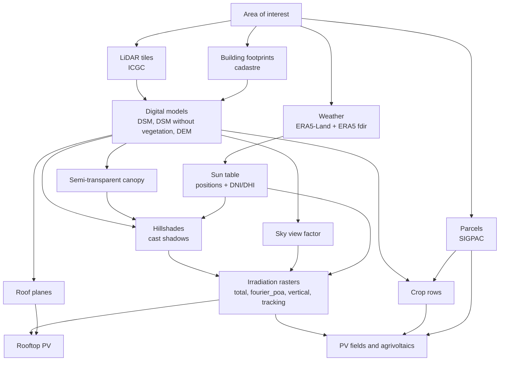

# greenshadow documentation

One document per computation. Each says what goes in, what comes out, how it
is computed, which parameters were tuned and against what, and what it does
not do. The repository [README](../README.md) is the overview;
[CHANGELOG](../CHANGELOG.md) lists what changed and when.

## The processing chain

`greenshadow.pipelines` runs the whole chain in one call per area; every
box above is also a public function that can be called on its own.

## Documents

| Document | Computation | Module |
|---|---|---|
| [pipelines.md](pipelines.md) | The chain in one call; adding a region | `greenshadow/pipelines/` |
| [data_sources.md](data_sources.md) | ICGC LiDAR, cadastre, SIGPAC, protected areas, ERA5, satellite | `lidar`, `rural_parcels`, `weather`, `satellite` |
| [digital_models.md](digital_models.md) | DSM / DEM from LiDAR: classification correction, cranes, gap filling, smoothing, tiling | `dsm_dem_estimation` |
| [hillshades_and_sky_view.md](hillshades_and_sky_view.md) | Sun tables, cast-shadow hillshades (CPU / CUDA), elevated shadows, videos, sky view factor | `shader` |
| [vegetation_canopy.md](vegetation_canopy.md) | Trees as a semi-transparent medium, tree crowns, growth since the flight | `shader` |
| [irradiance_era5.md](irradiance_era5.md) | Weather alignment and the beam/sky split, validated against PVGIS-SARAH3 | `shader`, `weather` |
| [solar_energy.md](solar_energy.md) | Irradiation rasters: modes, units, the one-pass reader, the POA bases | `shader` |
| [pv_tracking_irradiance_plan.md](pv_tracking_irradiance_plan.md) | Vertical and tracking bases, shading between rows, validation against pvlib | `shader`, `parcel_pv` |
| [roof_inference.md](roof_inference.md) | Roof planes from LiDAR and regularized facets | `buildings_infer`, `roofs_3d` |
| [rooftop_pv.md](rooftop_pv.md) | Modules and strings on the roof planes, per-building scenarios | `dimensionate` |
| [crop_rows.md](crop_rows.md) | Plantation rows and working axes of the rural parcels | `crop_rows` |
| [parcel_pv.md](parcel_pv.md) | PV fields and agrivoltaics on the parcels, costed and ranked | `parcel_pv` |

## Conventions used throughout

* **Azimuths** are degrees from North, clockwise (180 = South), for the sun,
  panels and rows alike. Slope and aspect **rasters** written by the
  digital-model builder are in **radians**; the per-plane `tilt_deg` /
  `azimuth_deg` columns of the roof planes are in degrees.
* **Energy units.** The `total`, `monthly` and `fourier_decomposition`
  irradiation rasters are **Wh per pixel** (Wh/m² × pixel area). The
  `fourier_poa`, `vertical_basis` and `tracking_basis` bases are **Wh/m²**.
  See [solar_energy.md](solar_energy.md#units).
* **Caching.** Every product is written to disk and reused on the next call
  unless an `overwrite` / `update` / `recalculate_*` flag says otherwise. A
  change upstream (e.g. a rebuilt DSM) does not invalidate what was derived
  from it; pass the flag.
* **CUDA** is used when a GPU, its driver and libNVVM are usable
  (`cuda=None`, the default, decides). Install the toolkit with
  `pip install "numba-cuda[cu13]"`. Every CUDA path has a CPU twin.

## Tests and evaluation scripts

All at the repository root, runnable as `python <script>`:

| Script | Checks |
|---|---|
| `test_aoi_masking.py` | AOI masking of the DSM builder |
| `test_crane_removal.py` | Crane / thin-tall-outlier filter on synthetic scenes |
| `test_hillshade_optimization.py` | Hillshade generation |
| `test_sky_view_factor.py`, `test_svf_simple.py`, `test_svf_large.py` | Sky view factor |
| `test_solar_energy_backends.py` | CPU and CUDA energy sums agree; one pass equals one call per mode |
| `test_tracking_basis.py` | Vertical and tracking bases against pvlib |
| `test_crop_rows.py` | Crop-row detection on synthetic canopies |
| `test_parcel_pv.py` | Parcel PV and agrivoltaic scenarios on a synthetic basis |
| `test_pipelines.py` | The region-agnostic pipeline on a synthetic DEM, offline |
| `eval_irradiance_pvgis.py` | Beam/sky split against PVGIS-SARAH3 for any point and year |
| `eval_crop_rows.py` | Detected crop rows against hand-drawn ones |
| `diagnose_crane.py` | Why each thin tall object was removed or kept |
