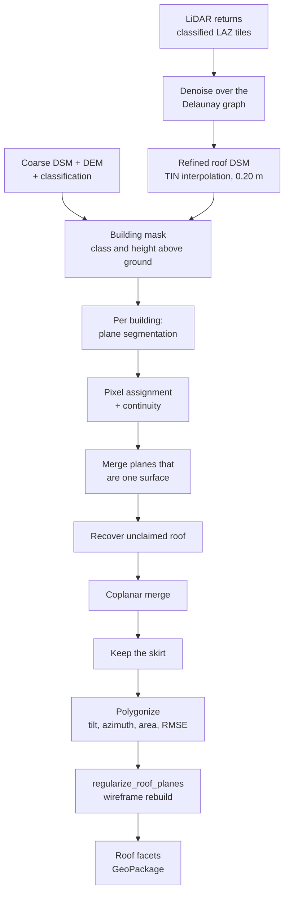
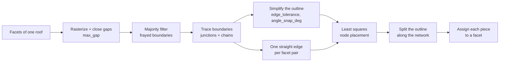

# Roof inference: from LiDAR returns to vector roof facets

How `greenshadow` turns airborne LiDAR and a DSM into the roof facets the PV
siting uses: one polygon per roof plane, each with a tilt, an azimuth and an
area. Everything described here lives in
[`greenshadow/buildings_infer.py`](../greenshadow/buildings_infer.py).

```python
import greenshadow as gs

planes = gs.detect_roof_planes(...)                      # raster detector
roofs  = gs.regularize_roof_planes(planes, dsm_path=...) # straight edges
gs.roof_planes_3d(roofs, dsm_path=..., laz_dir=...,
                  output_path="roofs.html")              # look at it
```

A worked call with every tuned parameter is in
[`example/get_solar_energy_from_municipality.py`](../example/get_solar_energy_from_municipality.py).

---

## 1. The problem

A roof is a handful of flat surfaces meeting along ridges, hips and valleys.
The LiDAR sees it as a few dozen returns per square metre, each with a
centimetre-to-decimetre error, plus chimneys, aerials, parapets and trees
leaning over the eaves. The output has to be *planar facets with clean
boundaries*, because a PV string is laid out on a plane and a facet whose
edge wanders by half a metre wastes real modules.

The pipeline therefore splits in two halves that fail differently:

* **Detection** decides *which pixel belongs to which plane*. Its errors are
  splits and merges: one real facet cut in two, or two facets read as one.
* **Regularization** decides *where the boundary runs*. Its errors are shape:
  a staircase edge, a ridge drawn twice, a hip that misses the corner.

Keeping them apart is what makes the accuracy numbers in §6 interpretable:
after regularization the mean agreement barely moves, so what is left is a
detection problem, not a geometry one.

---

## 2. The pipeline



Runtime for the 500 x 1000 pixel Alpicat test window (34 building parts, 112 real
planes): about 40 s for detection, 1-2 s for regularization.

---

## 3. Detection — `detect_roof_planes`

### 3.1 A better surface to read

The returns are **denoised before they become a raster**
(`delaunay_smooth_strength`). They are segmented into planes over their own
Delaunay graph and each point is pulled toward the plane of *its own*
segment, so noise goes and creases stay. A gaussian blur on the finished DSM
(`smooth_sigma`) rounds ridges as hard as it removes noise, and is off.

The refined DSM is then built at `resolution_refined` (0.20 m) with
`refined_aggregation="tin"`: each pixel centre is sampled off the
triangulation of the returns. Binning instead leaves roughly half the pixels
empty at this resolution and hands them to a gap filler that minimises
curvature — which rounds off the very facets being looked for.

### 3.2 Which pixels are roof

`buildings_mask = class in building_class_value AND (DSM − DEM) > min_height_m`.
Connected components of that mask are the *building parts*, and every later
step runs per part.

### 3.3 Segmentation, per building

1. **Normal clustering** (`preclustering_roof_planes`, `normal_tolerance_deg`)
   groups pixels whose normals agree, giving region growing a clean seed.
2. **Region growing + RANSAC** (`ransac_threshold`) turns each cluster into
   plane candidates. A pixel a region merely *reached* and rejected is not
   consumed, so a dormer tested against the main slope still gets a plane of
   its own.
3. **Assignment** hands every masked pixel to a plane by 3D distance
   (`assignment_normal_weight` adds an orientation term; measured inert here
   and left at 0).
4. **Continuity** splits a plane whose pixels are not connected.
5. **Graph merge** (`merge_normal_angle_deg`, `merge_max_offset_m`) fuses
   adjacent planes with the same orientation, guarded so two stacked flat
   roofs do not merge across their step.

### 3.4 Three repairs that matter

These were added after measuring where the roof was being lost. Each is off
by default and switched on in the example.

**`recover_distance_m` — roof the region growing left behind.**
7% of the real roof area sat inside the building mask but in no plane, often
a whole facet whose seed had been rejected. Unclaimed pixels are grown into
the neighbouring plane they fit within this vertical distance; a patch that
is still unclaimed and at least `min_roof_plane_area` large gets a RANSAC
plane of its own, unless it is steeper than `recover_max_tilt_deg` (a wall).

**`coplanar_merge_angle_deg` / `coplanar_merge_step_m` — one surface, split in two.**
The graph merge above misses pairs that are plainly one plane: a single
ridge-mask pixel on the shared boundary vetoes it, and it compares heights
at the pair's centroid, where a small slope difference is extrapolated into a
false step. This last pass measures the height step *along the seam the two
planes share*, merges the closest pair first, and refits the plane after each
merge so a chain of slightly different planes cannot creep into one.

In the digitised data, every touching pair within 3° and 0.15 m was one real
plane split in two (7 of 7); at 8° and 0.3 m only 12 of 20 were.

**`skirt_assign_distance_m` — the eaves.**
Along the building edge the refined DSM drops steeply over its last pixel or
two — the triangulation reaching from the eave down to returns on the facade.
Those pixels fit no plane, so the outline came out ragged and short of the
real eave: in the last half metre before the edge, 20-30% of the mask's
pixels were in no plane, against ~1% deep inside the roof, and they sit at a
median slope of 60° (deep inside: 13°). This pass
gives them to the nearest plane as the very last step. Planes are **not**
refitted with them and the planarity metrics exclude them, so only the
footprint changes.

### 3.4b Roof clutter — `svf_path`

Chimneys, aerials, lift overruns and air-conditioning units sit *on* a roof
plane without being roof. A panel cannot go there, and the facet polygon
should say so.

Height above the fitted plane cannot identify them on its own. At 0.20 m a
noisy return, a raised ridge tile and a real flue all clear the same
threshold, which is why `pv._obstacle_geometry` — the residual-only detector
that already existed, applied at layout time — has to be run at a
conservative `residual_m`. So the **sky view factor** is asked to confirm.

The signal is not where you would first look for it. An object standing on a
roof steals sky from the roof *around its base*, so it prints a **ring** of
depressed SVF; on the chimney's own top the sky is wide open again and the
SVF is back to its baseline. The detector therefore searches for the ring and
recovers the object as what the ring encloses — a morphological closing at
the radius of the largest object still called clutter, followed by a hole
fill.

Two tests, and dropping either one costs precision in a different way:

| Test | What it contributes | What it fails alone |
|---|---|---|
| `svf < plane median − svf_obstruction_drop` | an object is *there* | also flags the foot of a taller neighbour and the shaded flank of a ridge — real occlusions, still roof |
| DSM more than `svf_obstruction_min_height_m` above the fitted plane | *which* enclosed pixel is the object | flags noisy returns, ridge tiles and every eave lip |

**Scored against ground truth.** `real_roof_obstacles_9000_9500_4000_5000_Alpicat.gpkg`
digitises 48 obstacles over the test window (median 1.35 m², 75.8 m² total).
Measuring against it overturned the first design:

| | first attempt | per-plane, SVF-led |
|---|---|---|
| detections | 17 | 31 |
| recall | 2/48 (4%) | **16/48 (33%)** |
| precision | 12% | **52%** |
| IoU | 0.021 | **0.138** |
| detected area | 6.7 m² | **72.1 m²** (of 75.8) |
| real holes cut | 2.5 m² (7 rings) | **41.6 m² (14 rings)** |
| facets severed spuriously | 14 | 1 |

Two things caused the reversal.

**The obstacles are not in the refined DSM.** The median digitised obstacle
clears its own fitted plane by **0.09 m**, and only 9 of 45 clear 0.30 m.
`refined_aggregation="tin"` and `delaunay_smooth_strength` — the two settings
that make the facets clean — flatten a 0.5 m flue into the roof it stands
on. A height-led detector cannot find what the surface no longer contains,
which is why the first attempt recalled 4%.

**The SVF is the signal, not the confirmation.** It is built from the
*unrefined* DSM, which still has the clutter, and there it is unmistakable:
median depression **0.30** below the obstacle's own facet baseline, against
a roof-wide 90th percentile of 0.08. So `svf_obstruction_min_height_m`
defaults to **0** — asking the flattened DSM to confirm what the SVF found
only deletes real obstacles (8 holes → 2 at `drop=0.15`).

**Per-plane iteration matters.** Every quantity here is only meaningful
relative to one face: the baseline is per facet, and the morphology has to
stay inside the facet or a closing bridges a ridge and welds the shadow on
one side to the shadow on the other. Restructuring the same tests from
whole-building to per-plane took recall from 4% to 33% on its own.

**The remaining ceiling is the SVF raster's resolution.** At 0.5 m, the
shadow ring of a ~1.2 m object is barely resolved, so detections come out
larger than the object and offset by up to half a pixel — which is what
holds IoU near 0.14 even where the object is found, and what holds recall at
a third. A refined DSM built with `aggregation="max"` and no Delaunay
smoothing, used *only* as the SVF input, is the obvious next step.

Two details make it work on real roofs:

- The baseline is taken **per plane**, not per building. A north facet under
  a tree and a clear south facet share no SVF level to be depressed below.
  It is computed from the plane's *assigned* pixels only — let the clutter
  into the median and a cluttered facet raises its own bar until nothing on
  it is depressed any more.
- Both tests reach the clutter through **the nearest plane**, not its own. A
  chimney top stands a metre off the roof, far outside any RANSAC threshold,
  and is too small to be planed in its own right, so its pixels usually carry
  no `plane_id` at all. A distance transform answers each of them with the
  plane it stands on.

Candidates below `svf_obstruction_min_area_m2` are noise; above
`svf_obstruction_max_area_m2` they are a structure that deserves a plane of
its own rather than a hole, and are left alone.

`svf_obstruction_max_elongation` and `svf_obstruction_max_planes` are the
two tests that do the real work: a chimney is about as wide as it is long
and stands in the middle of one roof face, while a ridge, an eave or a step
is long, thin, and has a different face on either side. The second is
measured on what *surrounds* the blob, not what it covers, because the
clutter's own pixels are usually in no plane at all. Set
`svf_obstruction_max_planes=0` to disable that test.

`svf_obstruction_buffer_m` widens each hole for the strip of roof beside a
chimney that is clear but unusable.

The holes are subtracted from the **intact** facet polygon rather than
knocked out of the plane raster first — that is what lets an obstruction on
the facet edge be measured as a notch, and one that severs a facet keep both
halves as separate records instead of losing the smaller one.

Off unless `svf_path` is given. Pass the raster
`calculate_sky_view_factor` writes, in the detection CRS; it is resampled
onto whichever grid detection ended up on, refined or not. Note that an SVF
built at the coarse DSM resolution *localises* clutter on the refined grid
but does not sharpen it.

### 3.5 Output

`_polygonize_and_compute_parameters` vectorizes the plane raster and computes
per facet: `part_id`, `plane_id`, `tilt_deg`, `azimuth_deg`, `footprint_area`
(plan) and `area` (true, tilted), plus `planarity_rmse`, `planarity_mad` and
`roughness` as fit-quality flags, and `n_obstructions` / `obstruction_area`
for what `svf_path` cut out (0 when it is off).

Holes become **interior rings** of the facet polygon, so `footprint_area` and
`area` already exclude them and the PV layout in `pv` skips them without
being told — it tests candidate cells with `prepared.covers`, which honours
interiors.

Tilt and azimuth come from the fitted plane, never from the polygon, and
`_plane_slope_aspect` / `_plane_coefficients` are exact inverses — that is
what lets the regularizer and the 3D viewer lift a flat polygon back onto its
own plane.

**Determinism.** RANSAC is seeded (`_fit_plane_ransac(..., seed=0)`). Before
that, two identical runs differed by ~0.01 mean IoU, which was larger than
most parameter effects and made tuning unreliable.

---

## 4. Regularization — `regularize_roof_planes`

The detector polygonizes pixels, so each facet arrives with ~150 staircase
vertices and every shared ridge is drawn twice, once per side, a little
apart. Two methods turn that into usable geometry.

### 4.1 `method="wireframe"` (default)

Each **roof** — a set of facets that touch *and* meet without a wall — is
rebuilt as one planar wireframe, so neighbouring facets share their vertices
exactly instead of being straightened one by one.



* **Grouping.** Facets closer than `max_gap` form one roof, *unless* their
  planes differ in height by more than `wall_step_m` along the stretch where
  they face each other — a wall stands between them. Roofs separated by a
  wall are simplified independently, their contours are not pulled together,
  and the gap between them is not filled. Where two independent outlines
  overlap, the higher roof keeps its shape.
* **Gap closing.** Within a roof, gaps up to `max_gap` (unassigned ridge
  pixels) go to the nearest facet, so the facets tile the roof.
* **The network.** Pixel corners where three or more facets meet — or two
  facets meet the outside — are junction nodes; junctions closer than
  `node_merge_distance` are one junction. The boundary between two facets
  becomes a single straight edge whenever it follows the line where their two
  planes intersect, which is where a ridge or a hip geometrically is.
* **Node placement.** One least-squares solve pulls every node onto the
  plane-plane intersection lines of the edges meeting there, pins outline
  nodes to outline corners or lets them slide along the outline, and keeps
  the rest near where the pixels put it. Three facets meeting at a node
  therefore meet where their three planes share a point.
* **Cutting the facets.** The outline is split along the network and each
  piece goes to the facet covering most of it. A facet whose boundaries did
  not close is carved back from its own pixels, so no detected plane is lost.

Faces do not overlap by construction, and every ridge is one line shared by
both sides.

### 4.1b `method="intersections"`

The same wireframe - same outline, same junction topology, same faces - with
the nodes placed differently. Every boundary between two facets is first
turned into straight segments: the plane-plane line where it holds (as in
the wireframe), otherwise one line per Douglas-Peucker stretch, fitted to its
pixel corners by total least squares and turned onto the roof's dominant
orientation within `angle_snap_deg`. Each node then goes where the segments
meeting at it collide - least squares over their lines, the outline edge
included when the node sits on it - instead of staying at the pixel junction
with only the ridge lines pulling on it. A node whose segments are nearly
parallel, and would collide more than `2 * edge_tolerance` away, is held at
its pixel position.

On the `roofs_rasterised_v0` detection of the test window it scores within
0.003 mean IoU of the wireframe at every `edge_tolerance` from 0.2 to 0.6
(0.657 vs 0.659 at 0.45, same vertex count), and moves 15% of the facets by
more than 1% of their area: the ones with steps and wrap-around boundaries,
whose junctions come out as clean corners instead of short jogs. Ridges were
already straight lines, so most roofs do not change.

### 4.2 `method="facet"`

The older behaviour: simplify, snap each facet's edges to its own dominant
orientation, snap shared boundaries onto plane intersections, enforce
disjointness. Facets stay independent — no shared vertices — and keep ~29
vertices against the wireframe's ~12. `simplify_tolerance` and
`enforce_disjoint` apply only to this method.

### 4.3 The fidelity / simplicity trade

`edge_tolerance` is the dial. Measured on the digitised planes, with the
final detector:

| `edge_tolerance` | mean IoU | vertices per facet |
|---|---|---|
| 0.30 m | 0.698 | ~15 |
| **0.45 m (default)** | **0.691** | **~11** |
| 0.60 m | 0.684 | ~8 |

Larger values round the *small* facets away first, which is where the
accuracy goes.

---

## 5. Parameters that were tuned

Defaults in the library are the historical ones; the example passes the
tuned values. Everything below was measured against the digitised planes,
averaged over three RANSAC seeds.

### Detector

| Parameter | Library default | Tuned | Why |
|---|---|---|---|
| `resolution_refined` | 0.25 | 0.20 | pays off only with `refined_aggregation="tin"` |
| `refined_aggregation` | `smart_for_roofs` | `tin` | no empty pixels to invent |
| `delaunay_smooth_strength` | 0.0 | 0.2 | 0.35 merges small facets; 0.1 is worse |
| `normal_tolerance_deg` | 15 | 8 | 7 and 9 both cost ~0.015-0.02 IoU |
| `ransac_threshold` | 0.15 | 0.05 | inert 0.05-0.2; 0.1 measured worse here |
| `min_roof_plane_area` | 5 | 3 | small facets: mean IoU 0.30 → 0.51; 2 and 4 worse |
| `merge_normal_angle_deg` | 2.5 | 6.0 | 5, 7, 8, 10 all worse |
| `merge_max_offset_m` | 0.3 | 0.3 | guards two stacked flat roofs |
| `assignment_normal_weight` | 1.0 | 0.0 | distance-only measured better |
| `recover_distance_m` | 0.0 (off) | 0.15 | coverage 91% → 95% |
| `coplanar_merge_angle_deg` | 0.0 (off) | 8.0 | +0.011 IoU on every seed; 12° starts merging real facets |
| `coplanar_merge_step_m` | 0.15 | 0.15 | 0.3 cancels the gain |
| `skirt_assign_distance_m` | 0.0 (off) | 0.3 | raw IoU 0.697 → 0.703 |
| `dsm_max_slope_filter` | 0.4 | 1.9 | **radians**: 1.9 rad filters nothing; 1.3 measured no better |
| `svf_path` | None (off) | the pipeline's `svf.tif` | cuts chimneys and aerials out of the facets |
| `svf_obstruction_drop` | 0.12 | 0.12 | 0.08 and 0.20 both lose IoU; 0.15 costs recall |
| `svf_obstruction_min_height_m` | 0.0 (off) | 0.0 | the refined DSM has flattened the obstacles |
| `svf_obstruction_close_m` | 0.6 | 0.6 | 0 leaves rings unfilled, 1.0 merges neighbours |
| `svf_obstruction_min_area_m2` | 0.5 | 0.5 | precision 52% vs 42% at 0.15, same recall |
| `svf_obstruction_max_area_m2` | 15.0 | 15.0 | above this it wants a plane, not a hole |
| `svf_obstruction_max_elongation` | 2.5 | 2.5 | 3.0 costs 14 points of precision |
| `svf_obstruction_max_planes` | 1 | 1 | 2 doubles detections and halves precision |

### Regularizer

| Parameter | Default | Note |
|---|---|---|
| `method` | `wireframe` (example: `intersections`) | `facet` for the old per-facet behaviour |
| `max_gap` | 0.3 m | wider gaps are a step or a light well, not a missed ridge |
| `edge_tolerance` | 0.45 m | see §4.3 |
| `node_merge_distance` | 0.6 m | also snaps a hip end onto the building corner |
| `wall_step_m` | 0.3 m | 0.2 similar, 0.5 and 1.0 let real steps through |
| `angle_snap_deg` | 12 (example: 8) | barely matters (0-25 within 0.001 IoU) |
| `ridge_snap_tolerance` | 0.6 (example: 0.9) | how far a boundary may be from the plane-plane line |

Both `wall_step_m` and the ridge snapping need `dsm_path`: a plane's height
is not recoverable from tilt and azimuth alone.

---

## 6. How well it works

**Ground truth.** 112 roof planes digitised by hand over the Alpicat test
window (`real_roofs_9000_9500_4000_5000_Alpicat.gpkg`, EPSG:4326, reprojected
to 25831).

**Metric.** For each real plane, the best IoU against any detected facet;
the headline is the mean. It falls both when one real facet is shattered and
when several are merged, which a plane count cannot distinguish. Reported
alongside: the share of real planes matched at IoU ≥ 0.5, and *coverage*, the
share of real roof area the output covers.

| Stage | mean IoU | matched ≥ 0.5 | coverage |
|---|---|---|---|
| Starting point (previous example parameters) | 0.628 | 74% | 91% |
| + tuned parameters, incl. `recover_distance_m` | 0.686 | 84% | 95% |
| + coplanar merge | 0.698 | 86% | 95% |
| + skirts + `wall_step_m` (**current**) | **0.696** | **85%** | **95%** |

`recover_distance_m` is the coverage step rather than an IoU one: with the
same parameters it moved coverage from 90% to 95% and mean IoU from 0.684 to
0.686.

The last row trades ~0.002 of IoU for simpler shapes (`edge_tolerance` 0.45
rather than 0.3, ~11 vertices per facet instead of ~15).

By facet size, current pipeline: **< 15 m²** 0.51 · **15-40 m²** 0.66 ·
**> 40 m²** 0.78.

**What is left.** 128 facets for 112 real planes: the residual error is
mostly *which pixels went to which plane*, not edge shape. Two known causes:

* Weak creases. Two planes 37° apart in azimuth at a 10° tilt have no sharp
  ridge, and the split between them wanders.
* Roof outside the mask. ~200 m² of real roof (3.5%) is not in the building
  mask at all, so no parameter of the detector can reach it.

**Caveat.** Every number here comes from one 500 x 1000 pixel window of one
municipality. The tuned values may be partly fitted to it; a second digitised
area would be worth having before trusting them elsewhere.

---

## 7. The point-native detector — removed

There used to be a second detector, `detect_roof_planes_v2`, that never
rasterized: it built a 2D Delaunay graph of the returns, scored creases by
dihedral angle, grew plane segments over the graph, and emitted faces from
the triangle partition so faces never overlapped. It followed stage 1 of
*Delaunay Canopy: Building Wireframe Reconstruction from Airborne LiDAR
Point Clouds via Delaunay Graph* (ECCV 2026, arXiv:2604.02497).

It kept crisper creases, but its region growing stopped at every crease and
thin patch, so a roof came out in more pieces than the raster detector's.
No municipality run ever used it, and it has been **removed**.

`delaunay_canopy_roof_planes` — the face-polygon stage it wrapped, which
turned plane segments into non-overlapping triangle-partition faces and
snapped their shared boundaries onto exact plane-plane intersections — has
been removed with it, as has every helper that served only those two.

What survives is the part the **raster** detector depends on: the Delaunay
graph, its crease scoring (`delaunay_corner_scores`) and the plane
segmentation over it. `smooth_points_to_planes` /
`smooth_roof_points_by_building` need the segmentation — that is what
`delaunay_smooth_strength` (§3.1) calls to pull each return toward the plane
of its own segment, denoising the cloud without rounding the creases off.

---

## 8. Looking at the result

`gs.roof_planes_3d(...)` writes a standalone WebGL page (three.js): the
detected faces over the raw LiDAR returns of the whole area, coloured by
class. Hide a class to see the roofs' own returns; a face floating off them,
or roof returns carrying no face, is then obvious. `.png`, `.obj` and `.ply`
outputs are also supported. See
[`greenshadow/roofs_3d.py`](../greenshadow/roofs_3d.py).

---

## 8b. A whole municipality — `detect_roof_planes_tiled`

Run on a municipality in one call, the detector ran out of memory: at
`resolution_refined=0.20` Alpicat's 7 x 8 km grid is ~1.4 billion pixels
per array. `detect_roof_planes_tiled` takes the same arguments and runs
the detector tile by tile (`tile_size_m`, 1 km by default, matching the
ICGC LiDAR tiles), each tile in a forked process of its own.

**No roof is cut.** Building pixels are grouped into clusters - closer than
`cluster_gap_m` (2 m) is the same cluster - and each cluster goes whole to
the tile its centre falls in, whose window stretches to cover it. Each tile
gets an ownership mask (`building_owner_mask`), so overlapping windows never
detect a building twice. `part_id` is renumbered to stay unique and a
`tile_id` column is added. `aoi` keeps only the buildings touching it -
the municipality, while the rasters reach `aoi_buffer_in_meters` beyond it
for the shadows: clusters clear of it are never detected, and roofs
(`part_id`) with no facet touching it are dropped, a roof on the boundary
kept whole. `filter_roof_planes_by_aoi` does the second half on any detected
or regularized GeoDataFrame; on Alpicat it keeps 1,750 of 2,386 roofs. On the
Alpicat test window, 100 m tiles (every
roof near a tile edge) give 135 planes against 136 untiled, at the same mean
IoU (0.674); the one-plane difference is the TIN's long-triangle cut-off,
which is relative to the median edge of whatever is triangulated together.

**Memory.** Workers are sized to the free memory (`worker_ram_gb` each,
cgroup limits included), a tile starts only when the memory the running
ones may still grow into leaves room for it, and if free memory still falls
under a reserve (10% of RAM, at least 4 GB) the youngest tile is killed and
rerun alone later - never the desktop session. Finished tiles are kept in
`<output>_tiles/` until the end, so a run that dies resumes where it
stopped. The refined rasters of the tiles are mosaicked into the usual
`*_roofs.tif` files.

Three stages grew with the square of a building part and are now linear,
with bit-identical output: the normal pre-clustering (sklearn's DBSCAN kept
every neighbour list; `_dbscan_grid` reproduces its labels exactly on a
cell grid), `_recover_unassigned_roof` (a full-size residual raster per
plane) and `_refit_planes_from_assignment` (a full-size mask per plane).
Alpicat's old town, one contiguous cluster, went from >40 GB to 10 GB.

| Alpicat, whole municipality | |
|---|---|
| detection | 13,627 planes on 2,386 roofs, 24 min, 6 workers, peak 10 GB per tile |
| regularization | 13,585 facets, 45 s, 1.6 GB; 124 -> 9.5 vertices per facet |

**Precision.** The LiDAR coordinates used to be cast to float32, which
rounds a UTM northing near 4.6e6 m to 0.5 m - rows 2.5 refined pixels apart
- and the TIN was triangulated on raw UTM coordinates, where Qhull's
in-circle tests are ill-conditioned. Together they made the surface over a
roof depend on every other point triangulated with it (single pixels moved
by metres). Coordinates now stay float64 and are shifted near the origin
before triangulating. Mean IoU on the test window is unchanged (0.674);
what changed is that it no longer moves with the window - the float32
results drifted by ~0.02 IoU between windows. This applies to every DSM
built from LiDAR, not only roofs; cached rasterizations still hold the old
values until recomputed.

`regularize_roof_planes` scales the same way: it reads the DSM window by
window under each facet instead of whole (11 GB in float64 at 0.2 m), and
groups and rebuilds roofs over `n_workers` processes with the same result.

## 9. Module layout

Everything is in `greenshadow/buildings_infer.py`:

| Section | Contents |
|---|---|
| Public API | `detect_roof_planes`, `regularize_roof_planes` |
| Raster detector | mask, segmentation, assignment, merging, the three repairs, clutter removal, polygonization |
| Point-graph tools | Delaunay graph, crease scoring, plane segments, point smoothing |
| Regularization | wireframe rebuild (grouping, boundary graph, node solve, face cutting) and the per-facet method |
| Shared geometry | plane fitting, slope/aspect, LiDAR loading |

`greenshadow.buildings_infer_v2`, the deprecated shim that re-exported this
module, is gone along with the detector it was named for. Use
`greenshadow.buildings_infer`, or the package namespace.
