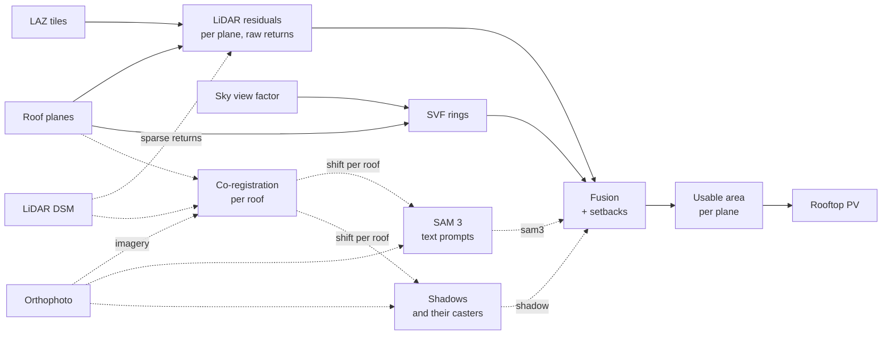
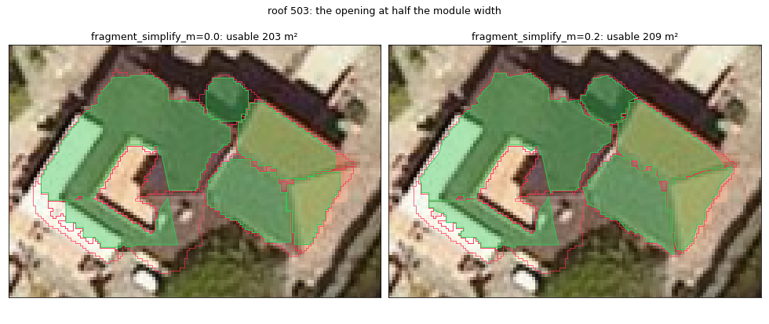
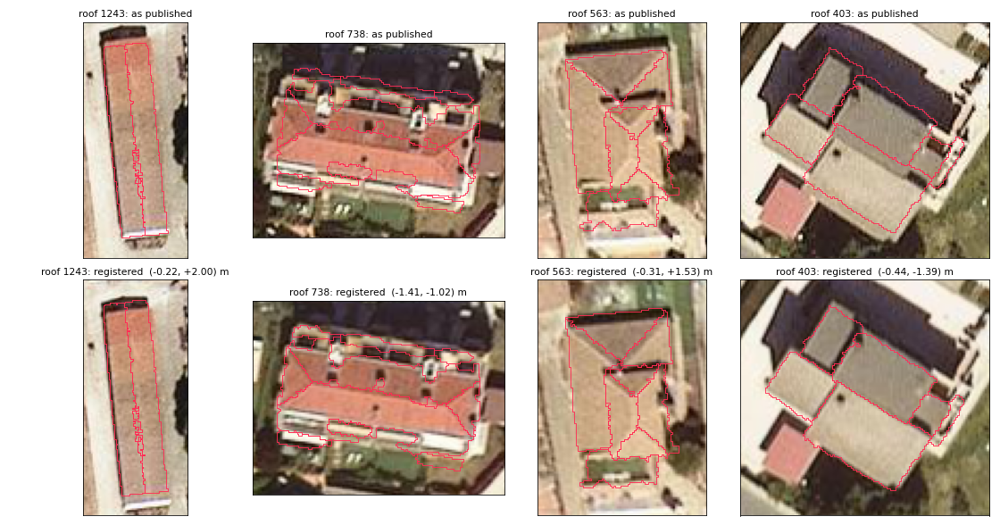
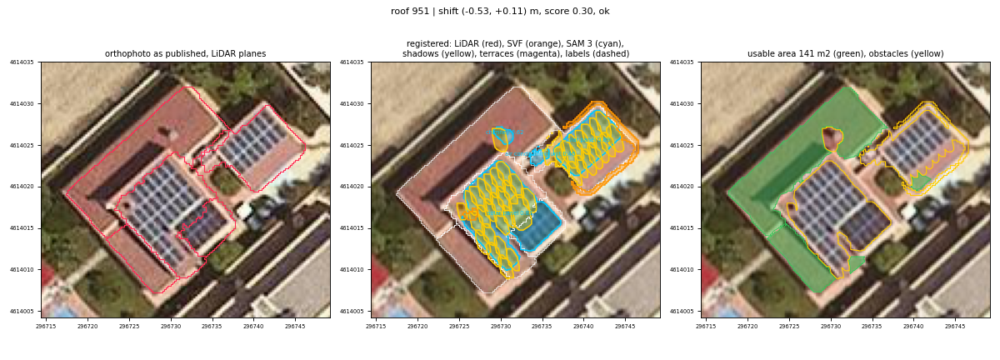
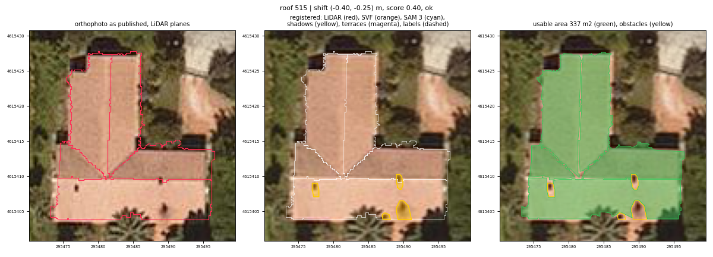
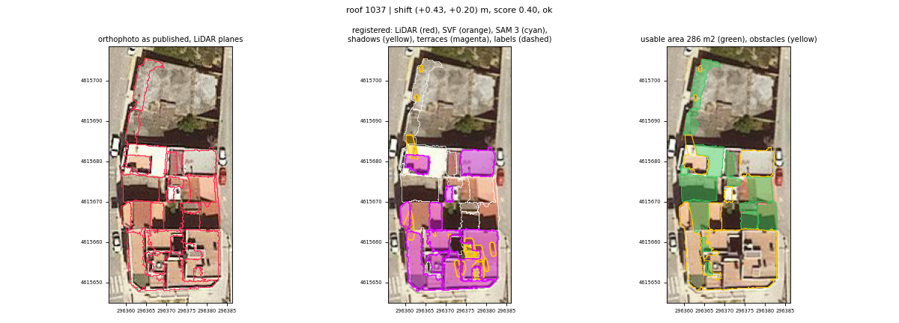
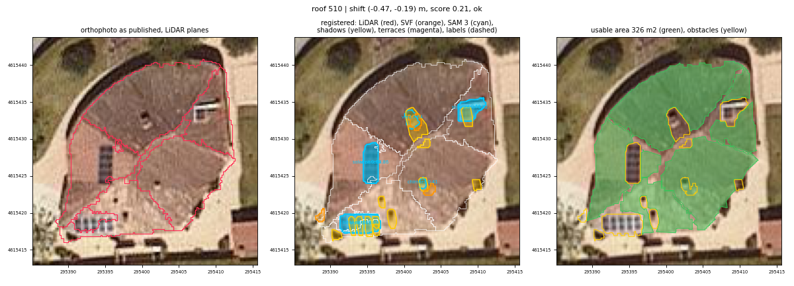

# Roof obstacles and the usable roof area

How `greenshadow.roof_obstacles` finds what stands on (or is sunk into) each
roof plane - chimneys, vents, air-conditioning units, parapets, lift rooms,
skylights, light wells - and cuts each plane down to the area a PV module
may be placed on. It runs between the roof planes
([roof_inference.md](roof_inference.md)) and the rooftop PV
([rooftop_pv.md](rooftop_pv.md)).

```python
import greenshadow as gs

cfg = gs.ObstacleConfig(lidar=True, lidar_classes=(1, 6, 17, 77))
lidar, qc = gs.detect_lidar_obstacles(planes, laz_paths, cfg,
                                      dsm_path="dsm_no_vegetation.tif")
# The pipeline's default (ObstacleConfig.lidar=False): no LiDAR obstacles
# qc = gs.planes_qc_without_lidar(planes); lidar = None
svf = gs.detect_svf_obstacles(planes, "svf.tif", cfg)
obstacles, usable = gs.fuse_obstacles(planes, [lidar, svf], cfg, planes_qc=qc)
gs.write_obstacle_layers("roof_obstacles.gpkg", obstacles=obstacles,
                         usable_area=usable, planes_qc=qc)

modules, summary = gs.plan_pv_strings_in_buildings(
    planes, buildable_areas=usable, ...)

# Optional: the orthophoto, registered on the LiDAR roof by roof
ortho = gs.icgc_orthophoto(planes, "icgc_orthophoto", year=2022)
coreg = gs.coregister_orthophoto(planes, ortho, "dsm_no_vegetation.tif", cfg,
                                 lidar_date="2022-05-28")
image, transform = gs.read_orthophoto(ortho, bounds, crs=planes.crs,
                                      shift=(coreg.dx[0], coreg.dy[0]))
cfg.sam3_python = "~/PyVenvs/sam3/bin/python"   # torch + transformers there
sam3 = gs.detect_sam3_obstacles(planes, ortho, coreg, cfg, cache_dir="cache",
                                dsm_path="dsm.tif")
shadows = gs.detect_shadow_obstacles(planes, ortho, coreg, "dsm.tif", cfg)
obstacles, usable = gs.fuse_obstacles(planes, [lidar, svf, sam3, shadows], cfg,
                                      planes_qc=qc)

# Validation against hand labels, and debug figures
sample = gs.sample_roofs_for_labelling(planes, per_type=5)
gs.write_labelling_template("labels.gpkg", sample)            # label in QGIS
truth = gpd.read_file("labels.gpkg", layer="obstacles")
table = gs.validate_obstacles(planes, detections, truth, sample, cfg)
gs.write_debug_pngs("debug", sample.part_id, planes, ortho=ortho, coreg_log=coreg,
                    detections=detections, obstacles=obstacles, usable=usable, truth=truth)
```



The dotted branch is optional (`ObstacleConfig.imagery`): the orthophoto is
registered on the LiDAR roof by roof, SAM 3 segments it
(`ObstacleConfig.sam3`) for what the LiDAR cannot see, and what stands on a
roof is found by its shadow (`ObstacleConfig.shadows`). Without imagery the
stage runs on the LiDAR and the SVF alone.

The obstacles stay in every DSM: they still cast shade on the roof around
them, and the hillshades and irradiation rasters keep that. Only the area a
module may stand on changes.

## 1. Why the raw returns

The planes are fitted to the refined roof DSM, which is built to make facets
clean - TIN sampling plus Delaunay smoothing - and which flattens clutter
into the roof: on the digitised Alpicat obstacles the median one cleared its
plane by only 0.09 m there ([roof_inference.md §3.4b](roof_inference.md)).
The DSM-residual cut the PV planner used to do on that surface
(`obstacle_residual_m`) could only find the tallest ones.

The residuals are therefore measured on the **LiDAR returns**, against each
plane **refitted to them**. On the Alpicat test window the ICGC returns
inside the roof planes are ~21 pts/m²; their spread about the refitted plane
is 0.016 m (median MAD σ) and the plane RMSE 0.019 m, so a 0.20 m object is
ten sigmas out.

The class matters. ICGC class 77, "other constructions", is where most
rooftop structures are: its returns inside the planes stand a median
**0.95 m** above them, against 0.00 m for class 6. Class 12 (overlap) mixes
roof and ground returns and is left out; ground, key-point and vegetation
classes never are obstacles. `CataloniaMunicipalityPipeline` reads classes
1, 6, 17 and 77 (`ROOF_OBSTACLE_CLASSES`); the default elsewhere is ASPRS 1
and 6.

## 2. LiDAR residual detector — `detect_lidar_obstacles`

Per roof (`part_id`), with the returns read once per tile group in a forked
process:

1. **Outline.** The roof's planes are unioned and gaps under
   `outline_close_m` closed. Returns inside it are kept.
2. **Home plane.** Each return goes to the plane it falls in, or to the
   nearest one (`STRtree.query_nearest`).
3. **Refit.** Each plane is refitted on its interior returns - RANSAC
   (`fit_threshold_m`, `fit_iterations`, seeded), then least squares on the
   inliers. If the refit leans more than `max_refit_angle_deg` off the
   detector's plane it has locked onto something else: the detector's
   orientation is kept, at the returns' median height (`fit="detector"`).
4. **Threshold.** σ = 1.4826 · MAD of the interior residuals (orthogonal,
   signed); a return is a candidate when |r| > max(`residual_k`·σ,
   `residual_min_m`) - 3σ and 0.20 m by default.
5. **Boundaries.** Within `boundary_buffer_m` of a plane boundary, and in
   the gaps between planes, a return belongs to two surfaces or to a facade.
   There it counts only if it stands above **every** plane within reach by
   more than max(threshold, `boundary_keep_above_m`): a chimney on the
   ridge is kept, while the eave drop, a facade seen at an angle and the
   wall of a step between two roof levels - all below one of the planes -
   are not. Returns in a gap farther than the buffer from any plane (a
   patch the detector left unplaned) are tested like interior ones.
6. **Clusters.** Candidates are clustered in plan with DBSCAN
   (`buildings_infer._dbscan_grid`), positives and negatives apart, with
   eps = clip(`cluster_eps_factor` / √density, `cluster_eps_min_m`,
   `cluster_eps_max_m`) and `cluster_min_samples` returns.
7. **Footprint.** Concave hull (`hull_ratio`, convex hull for degenerate
   clusters), widened by `hull_buffer_factor` × the point spacing.

**Minimum detectable obstacle.** About `cluster_min_samples` / density m²:
0.2 m² at the ICGC's ~15 pts/m², but 1.5-3 m² at 1-2 pts/m². For sparse
surveys lower `cluster_min_samples` (to 1-2) and rely on the raster residual.

**Raster residual.** Where a plane has fewer than `raster_min_density`
pts/m² (`raster_mode="fallback"`), or always (`"both"`), DSM − plane is
thresholded the same way and polygonized (`method="raster"`). The DSM must
still hold the clutter: the pipeline passes the 0.5 m LiDAR DSM (max
aggregation), never the refined roof DSM. The plane height is re-anchored on
the DSM, since a max-aggregated cell sits above the plane at its centre by
up to half a pixel times the slope. Without LAZ files this is the whole
detector.

**Outputs.** `obstacles`: `part_id`, `plane_id` (where most of its returns
are), `source="lidar"`, `method`, `sign` (+1 standing out, −1 sunk in),
`max_height_above_plane` (the signed extreme residual), `mean_residual`,
`n_points`, `area`. `planes_qc`: per plane, `n_points`, `density_pts_m2`,
`rmse_m` (of the roof returns, obstacles excluded), `sigma_m`,
`threshold_m`, `outlier_fraction`, `refit_angle_deg`, `fit`, `method` and
**`needs_review`** - set when there was no fit, too few returns
(`min_plane_points`), `rmse_m > max_plane_rmse_m`,
`outlier_fraction > max_outlier_fraction`, or a refit that tilted away.
A flagged plane is still used; it marks a cluttered roof or a doubtful
plane for a look.

## 3. Sky view factor detector — `detect_svf_obstacles`

The detector of `detect_roof_planes(svf_path=...)`
([roof_inference.md §3.4b](roof_inference.md)) - an object steals sky from
the roof around its base, printing a ring of depressed SVF - run on the
finished planes, roof by roof, at `svf_resolution_m` (0.2 m), with the
`svf_*` parameters tuned there. It sees objects whose returns the
classification or the thresholds missed; on its own it recalled 33% of the
digitised obstacles at 52% precision. `source="svf"`.

## 4. Fusion and usable area — `fuse_obstacles`

Overlapping detections of one roof become one obstacle whatever their
source; `sources` lists them (`"lidar"`, `"svf"`, `"lidar,svf"`). Then, per
plane:

```
usable = plane shrunk by seam_setback_m
       ∩ roof outline shrunk by edge_setback_m
       − obstacles buffered by obstacle_setback_m
```

opened at half `min_fragment_width_m` and stripped of pieces under
`min_fragment_area_m2` (true area on the roof). The opening is mitred and
runs on the piece simplified by `fragment_simplify_m` (one roof pixel),
then cut back to the piece, so that corners survive: on the stair-stepped
pixel outline of a roof turned against the grid it acted as an
axis-aligned square and took a triangle out of every corner. Both default to the narrowest and smallest of the PV modules
tried, so what is left can hold one. The **edge** setback applies along the
roof's outer edge only; the seams between two planes of one roof take the
small `seam_setback_m`.



`usable_area` has one row per plane with anything left: the plane's columns
plus `roof_area_m2` and `usable_area_m2` (true area, on the roof),
`obstacle_area_m2`, `n_obstacles` and `needs_review`.

## 5. Orthophoto and co-registration — `coregister_orthophoto`

What a LiDAR return cannot see - a skylight flush with the tiles, a roof
window, PV modules already there - an orthophoto can. Before anything found
on it can be cut from a plane, the image has to sit on the LiDAR, and an
orthophoto does not: it is rectified on the terrain, so a roof shows up
displaced by its lean (height × tan(off-nadir), away from the photo's
nadir) on top of the orthophoto's own error (0.5-1 m).

**Sources** (`greenshadow.orthophoto`):

* `icgc_orthophoto(footprints, out_dir, year=...)`: the ICGC territorial
  orthophoto, RGB, 25 cm, EPSG:25831, CC BY 4.0. Each year (2009 onwards)
  is one GeoPackage of the whole of Catalonia (~210 GB) on
  datacloud.icgc.cat; only the 1 km tiles that hold buildings are read,
  through HTTP range requests, and kept as local GeoTIFFs (JPEG q90, ~6 MB
  a tile), shared between municipalities. Native pixels, no WMS. The flight
  window of every sheet is published for the current edition only
  (`year="current"`); an older edition is dated 1 July of its year. The
  Catalan pipeline takes the edition closest to the LiDAR flight
  (`nearest_icgc_orthophoto_year`): the same roofs, at the cost of missing
  what was built since.
* `local_orthophoto(path_or_dir, date=...)`: any raster GDAL reads - PNOA
  sheets from the CNIG download centre (which has no scriptable download, so
  they are fetched by hand), a VRT, a COG URL - in any CRS.

`read_orthophoto(ortho, bounds, crs=..., shift=(dx, dy))` reads a crop onto
a north-up grid of the LiDAR's CRS at native resolution (bilinear), from as
many rasters as it spans, NaN where there is no imagery; `shift` undoes a
roof's displacement in the same single resampling.

**Registration**, per roof (`part_id`):

1. Edges of both on the same grid: the gradient magnitude of the
   orthophoto's brightness, and of the LiDAR - the DSM's slope, clipped at
   `coreg_slope_clip` so that every wall weighs alike, plus the plane
   boundaries (ridges, hips, steps) - each smoothed by
   `coreg_edge_sigma_m`. The LiDAR's covers the roof outline plus
   `coreg_pad_m`; the orthophoto's `coreg_max_shift_m` more each way.
2. Their normalised cross-correlation at every displacement within
   ±`coreg_max_shift_m` (`skimage.feature.match_template`).
3. **Consensus.** One roof's correlation surface is often flat or has
   several peaks - few edges, a cast shadow, a tree. The neighbourhood's has
   one: the orthophoto's error varies slowly, and so does lean between
   neighbours. The surfaces of the roofs within `coreg_neighbour_radius_m`
   are averaged; with fewer than `coreg_min_neighbours`, or no clear peak
   (under `coreg_min_score`), the average of every roof stands in.
4. The roof's shift is its own peak within `coreg_local_radius_m` of the
   consensus peak (taller roofs lean further), refined to sub-pixel by a
   parabola. A roof below `coreg_min_area_m2`, or whose own peak scores under
   `coreg_min_score`, takes the consensus shift; with no trusted consensus
   either, it gets no imagery.

`coreg_log`, one row per roof (its outline): `dx`, `dy` - where the
orthophoto shows the roof relative to the LiDAR, metres east and north; a
polygon drawn on the image maps back by (−dx, −dy) - `shift_m`, `score`,
`consensus_dx/dy/score`, `n_neighbours`, `status` (`ok`, `consensus`,
`low_score`, `at_limit`, `too_small`, `no_image`), `use_imagery`, `image`,
`image_date` (the sheet's mid-window, or the edition's date), `lidar_date`
and `date_gap_years`. A warning names the roofs flown more than
`max_date_gap_years` apart: roofs change (new modules, extensions).

**Checks.** On a synthetic village rendered with a known (1.3, −2.1) m
offset the median shift comes back within 0.03 m and every roof within
0.25 m (its own cast shadow pulls it), a taller roof's extra lean included;
the same orthophoto warped to UTM 30 registers alike. On the real
orthophoto, shifting the 2022 Alpicat tiles by exactly (1.3, −2.1) m moves
the measured shifts by that to 0.03 m (median; 0.10 m at the 90th
percentile).



## 6. SAM 3 on the orthophoto — `detect_sam3_obstacles`

[SAM 3](https://github.com/facebookresearch/sam3) (Meta, November 2025)
segments every instance of a concept named by a short noun phrase. It runs
through the Hugging Face port (`transformers>=5`, `Sam3Model` /
`Sam3Processor`), whose API was checked against the official repository and
the transformers documentation, not assumed:

* **Checkpoint**: `facebook/sam3` on the Hugging Face Hub, **gated** - request
  access on its page (name, affiliation; Meta reviews it), then
  `hf auth login` in the interpreter that runs it. Any local directory with
  the same files works too (`sam3_model`).
* **Licence**: the SAM License - commercial use allowed; attribution in
  publications; trade-control restrictions; the licence travels with the
  weights. Its code and weights are not redistributed here.
* **Runtime**: PyTorch, CUDA when there is a GPU (bfloat16), the CPU
  otherwise (float32). A 1008 px window with seven prompts takes 0.17 s of
  model time on an RTX PRO 5000 (3.2 GiB at four windows a batch) and
  20.6 s on 16 CPU threads. On Alpicat's 1,600 windows with the real weights
  and eight prompts the stage took ~9.5 min on the GPU (shared with another
  job), reading and resampling the orthophoto included; a rerun from the
  cache still reads every window (the key is its pixels), ~6 min.

**Its own interpreter.** torch's CUDA wheels pin the CUDA runtime libraries;
in an environment where numba-cuda runs the hillshades on CUDA 13.4, `pip
install torch` would downgrade them. `greenshadow/sam3_worker.py` imports
only numpy, torch and transformers, so SAM 3 can live in a venv of its own
(`python -m venv ~/PyVenvs/sam3 && ~/PyVenvs/sam3/bin/pip install torch
torchvision "transformers>=5"`) and serve the pipeline over a pipe
(`ObstacleConfig.sam3_python`, `--sam3-python`, `$GREENSHADOW_SAM3_PYTHON`).
With `sam3_python=None` it runs in-process. When it cannot run - no torch,
no access to the checkpoint - the stage warns, says what to do, and goes on
with the LiDAR and the SVF.

**Windows.** For every roof `coreg_log` lets use the imagery, the orthophoto
is read `sam3_upsample` times finer than native (cubic; 3× by default, so a
0.6 m chimney is 7 pixels instead of 2-3), undoing the roof's shift, in
windows of the model's input size (1008 px, 84 m at 0.25 m × 3) centred on
the roof outline plus `sam3_pad_m`; larger roofs are tiled with
`sam3_tile_overlap_m`. Each window gets every prompt of `sam3_prompts`
(chimney, skylight, roof window, roof hatch, solar panel, solar panels,
solar PV, air conditioning unit, HVAC system, vent, antenna, dormer): one vision encoding, one text encoding per prompt for the run, one
decoder pass per prompt and batch.

**Filters**, all in `ObstacleConfig`: score ≥ `sam3_min_score` (mask pixels
at `sam3_mask_threshold`); area within `sam3_min_area_m2` -
`sam3_max_area_m2`; at least `sam3_min_inside_fraction` on the roof; at
most `sam3_max_roof_fraction` of it (a mask of the whole roof is the roof);
not mostly shadow (more than `sam3_max_shadow_fraction` of its pixels darker
than `sam3_shadow_brightness`; a little one is kept as a shadow obstacle, see
below). Kept masks are clipped to the roof outline,
simplified (`sam3_simplify_m`), and of two overlapping beyond
`sam3_duplicate_iou` (a skylight that is also a "roof window") the higher
score stays. Masks are drawn on the registered crop, so they already lie on
the LiDAR planes.

**Existing PV.** Panels already on a roof are flat on it - a few centimetres
to 0.2 m above the tiles, under the LiDAR thresholds - so they are SAM 3's
alone, and they must come out of the usable area. "solar panel" alone
mostly segments single modules or rows; "solar panels" outlines whole
arrays (on 16 PV roofs of Alpicat, 3× the area at the same score), so both
are asked, and "solar PV" with them. Their masks (`sam3_extensive_prompts`) skip `sam3_max_area_m2`
and the shadow test - PV is dark, and arrays reach 1,000 m² - but the
plural also takes whole light roofs for panels: on Alpicat the 20 largest
masks were mostly metal, fibre-cement and white roofs, covering ≥ 0.96 of
their roof with a 25th percentile of brightness of 0.58-0.94, where the
real arrays covered 0.04-0.39 of theirs at 0.23-0.53. Hence
`sam3_extensive_max_roof_fraction` (0.8) and
`sam3_extensive_max_brightness` (0.55, on the 25th percentile of the mask's
mean RGB). The masks of one roof are then closed over gaps up to
`sam3_array_close_m` (1 m) into arrays, `class="solar panel"`: the gaps
between rows (kept for shade) are not free roof. Arrays are not weighed
against the other prompts - a block of panels is also a "roof window" or a
"vent" to SAM 3, sometimes with the better score.



**Cast shadows.** A cast shadow is dark, flat and often rectangular, and
SAM 3 takes it for panels: on Alpicat, the shade of an eave or parapet along
a lower roof (9-24 m² strips) and that of the domes on an industrial roof
(5-6 m² squares), 8 of the 253 arrays. They are told apart by geometry, not
colour - neither brightness, blueness nor texture separated them. Given a
DSM with what casts shadows (`dsm_path`; the pipeline passes the DSM with
the trees), the stage

1. finds the **sun of the orthophoto** (`estimate_orthophoto_sun`; the
   ICGC publishes flight dates, not times): for each flight date of
   `coreg_log`, up to `sam3_sun_sample_roofs` (80) roofs with
   `sam3_sun_pad_m` (15 m) around them are read, and the azimuth and
   altitude are those whose DSM shadows best correlate with the image's
   dark pixels - a 15° × 5° grid, then 3° × 1° around the best. Alpicat
   2022: 168° / 56° (a late-morning flight, r = 0.32), in 45 s; on a synthetic
   block drawn under 150° / 50°, 150° / 48°. Below
   `sam3_sun_min_correlation` (0.1), or with `sam3_sun` given, no estimate.
2. **predicts the shade** of each roof under that sun: a pixel is in shade
   where the DSM toward the sun rises above the sun's ray by more than
   `sam3_shadow_min_height_m` (0.15 m) within `sam3_shadow_max_distance_m`
   (40 m), nearest-pixel sampling so that a two-pixel chimney keeps its
   shadow. Each shaded pixel also gets its caster: the first pixel on the
   way to the sun that shades it.
3. tests each extensive mask: more than `sam3_extensive_max_cast_shadow`
   (0.5) of it in the shade, and it is no PV. The shadows SAM 3 took for PV
   lay 0.70-1.0 in the predicted shade, the real arrays at most 0.46 (a
   3 m² one; an array under a wall, 0.38).

**Little shadows are obstacles.** A little shadow on a roof is cast by
something on it - most often a small chimney the LiDAR barely resolves - so
a shadow mask (a PV mask in the predicted shade, or a dark mask of another
prompt) becomes an obstacle of class `"shadow"` when it is at most
`sam3_shadow_obstacle_max_area_m2` (8 m²), compact (minimum rotated
rectangle at most `sam3_shadow_obstacle_max_elongation`, 2, long for its
width) and, if the DSM predicts it, cast from the roof itself (the caster
within the outline, holes filled). It is widened toward the sun over its
caster: as far as the DSM puts the caster, plus the shadow's width across
the sun - a compact caster is about as deep - or `sam3_shadow_caster_m`
(0.5 m) when more. Every other shadow is dropped: shade from a neighbour or
a tree, and the long shade of a wall or of a higher part of the roof
(elongation 2.7-5.8 on Alpicat, against 1.1-1.5 for the domes). Shadows are
deduplicated among themselves only: SAM 3 often has the same dark patch as
a "vent" with the better score, and the fusion joins the two, so the
obstacle covers the caster. On the industrial roof the six widened shadows
fall on the domes the DSM holds.

**Cache.** Per window, keyed on its pixels, the model, the prompts and the
two thresholds the model applies: what the model returned, as outlines. A
rerun - other area, inside or shadow filters, another fusion - does no
inference; other prompts or another orthophoto do.

**Outputs** (`detections`, `source="sam3"`, `method="image"`): `class` (the
prompt, or `"shadow"`), `score`, `image_date`, `plane_id`, `area`. In the
fused `obstacles`, `classes` and `score` carry them over (`sources` e.g.
`"lidar,sam3"`); `coreg_log` gains `n_sam3`, `sun_azimuth`, `sun_altitude`
and `sun_correlation` per roof.

**Checks.** `.claude_tests/test_sam3.py` checks the geometry, filters,
arrays, cache and pipeline with a stand-in segmenter on the synthetic
village (a painted skylight comes back where the LiDAR has it, 0.03 m off,
through the shift; a ground patch and a whole flat roof are dropped, a
little black shadow becomes a `"shadow"` obstacle; rows 0.8 m apart become
one array; a rerun infers nothing), and the worker protocol with a tiny
randomly initialised SAM 3 in the separate venv.
`.claude_tests/test_cast_shadows.py` draws a block's shadows analytically
under a known sun and checks the sun estimate, the predicted shade of a
chimney (cast from the roof) and of a tall neighbour (from off it), and the
widening toward the caster. The real model was then run on all of Alpicat (section 13).

## 7. Shadows on the orthophoto — `detect_shadow_obstacles`

What stands on a roof casts a shadow, even when the LiDAR barely resolves it
and SAM 3 names nothing: a vent pipe, a small chimney, an antenna. On
Alpicat SAM 3 found nothing at all on some roofs with three vents in plain
sight. The detector reads the registered orthophoto of each roof
(`ObstacleConfig.shadows`, on with imagery) under the orthophoto's sun
(`orthophoto_suns`: `coreg_log`'s `sun_*` columns, else `sam3_sun`, else
`estimate_orthophoto_sun`, §6):

1. **Brightness relative to the plane.** Each plane faces the sun
   differently, so each pixel is divided by its plane's
   `shadow_reference_percentile` (60th) of brightness. Within
   `shadow_edge_m` (0.5 m) of a seam, it is divided by that of the darkest
   plane there: the registration leaves a pixel or two of a dark plane on its
   brighter neighbour, which would read as a shadow strip along every
   ridge; a chimney's shadow on a ridge is darker than both planes. The
   roof's outer `shadow_edge_m` is not read; its holes are, since a chimney
   is often a hole in the planes and its shadow lies against it.
2. **Shadows.** The pixels under `shadow_grow_ratio` (0.8) connected to
   one under `shadow_dark_ratio` (0.6), none green (2G − R − B above
   `shadow_max_green`, 0.04: a tree's crown over the eave). The hysteresis
   keeps a long shade in one piece where the roof's texture would break it
   into compact bits. A shadow is kept when it is `shadow_min_area_m2` -
   `shadow_max_area_m2` (0.25-4 m²), at least half of it
   `shadow_min_inset_m` (0.5 m) inside the roof's outer edge, and compact
   (minimum rotated rectangle at most `shadow_max_elongation`, 2.5, long
   for its width) or a pole's: along the sun (within
   `shadow_along_sun_deg`, 20°) and at most `shadow_pole_max_width_m`
   (0.5 m) across.
3. **Not cast from elsewhere.** The DSM's shade under the sun (§6) drops a
   shadow that lies more than half in shade cast from off the roof (a
   neighbour, a tree), or from further than `shadow_max_caster_distance_m`
   (3 m) across it (a higher part of the building).
4. **The caster.** It stands on the shadow's sun side. The obstacle, class
   `"shadow"`, is the shadow widened toward the sun as SAM 3's shadows are
   (§6): as far as the DSM puts the caster, plus the shadow's width across
   the sun (a compact caster is about as deep), at least
   `sam3_shadow_caster_m`. Its height, in `max_height_above_plane`, is the
   shadow's length along the sun, less half its width across (an oblique
   sun wraps the shadow around the caster's sides), times tan(altitude)
   plus the plane's rise along the shadow: on the synthetic block 0.85 m
   for a 1.2 m vent and 1.63 m for a 2 m chimney, about 0.35 m short.

On Alpicat it finds 6,659 shadows on 1,042 roofs in 10 s; 3,428 of them
touch no other source's detection. Of 30 of those drawn at random, by eye 19
were vents, chimneys and other objects, 3 false (a tree's crown, the shade in
a valley), the rest unclear; an earlier version without the pole width and
caster distance limits also let through wall shade. Some lit chimneys whose
shadow is shorter than a pixel or two are still missed. `source="shadow"`,
`method="image"`, `score` the shadow's darkness (1 − its relative
brightness), `n_points` its pixels; `coreg_log` gains `n_shadows`.

**Checks.** `.claude_tests/test_cast_shadows.py` adds a 0.4 m vent 1.2 m
tall to the synthetic block, drawn in the orthophoto only, and half a metre
of dark eave: one obstacle on the chimney's roof and one on the vent's,
covering the vent; none under the tall neighbour's shade or along the
eave; none without a sun.



## 8. Walkable terraces, balconies and patios — `detect_terraces`

A flat roof people walk on - a tiled *terrat*, a balcony, a patio among the
higher floors of a row house - takes no module, whatever room it has. On
Alpicat 3,029 of the 10,976 planes are flat (`tilt_deg` ≤
`terrace_max_tilt_deg`, 5°) and at least `terrace_min_area_m2` (2 m²); the
detector decides which of them are terraces and takes the whole plane out
(`source="terrace"`, `class="terrace"`; the fusion merges it with whatever
else lies on it, and the obstacle setback keeps modules off its edge on the
planes around).

**Guard.** A terrace has a parapet or a railing around it, or the walls of
the floors above it: no one is let onto a roof without. At every DSM pixel
along the plane's outline (the DSM without vegetation, so that a tree is no
railing), the highest surface within `terrace_guard_search_m` (1 m) is
compared with the plane's median height; the guard is the fraction of the
outline where it rises `terrace_guard_height_m` (0.8 m) or more. Two kinds
of plane come out:

* **enclosed** - guarded along `terrace_enclosed_min_guard` (0.75) of the
  outline and no larger than `terrace_enclosed_max_area_m2` (60 m²): a patio
  or a terrace among higher floors, whatever its finish. On Alpicat these
  are mostly the rear terraces and patios of the row houses, light-tiled,
  grey or in shade as often as terracotta. A larger flat roof behind a
  parapet (a block's, a warehouse's) stays usable.
* **tiled** (needs the registered orthophoto) - guarded along
  `terrace_tiled_min_guard` (0.5), and at least
  `terrace_min_finish_fraction` (0.5) of the plane, 0.25 m in from its edge,
  a walkable finish: ceramic tile (HSV hue 8-38°, saturation ≥ 0.22, value
  ≥ 0.3), garden (artificial grass, planters) or pool water. Gravel,
  membranes and white coatings are below the saturation, red metal sheet
  below the hue.

What the guard keeps out: on 36 flat, tile-coloured planes with a guard
under 0.5, drawn at random, nearly all were pitched tile roofs the plane
detector had fitted flat across their ridge, or low roofs with no parapet;
the top roofs of blocks, behind parapets of 0.3-0.5 m, read near 0. What
the rule takes, by eye on 36 random positives: rear terraces and patios of
row houses, tiled roof terraces with furniture or a pool, a few small
light wells and shaded courtyards (no loss: nothing would be placed there
either), and one flat area holding air-conditioning units. Planes the rule
leaves are mostly top flat roofs (gravel, membrane, white) and
mis-fitted pitched roofs; a few walkable top roofs with low railings are
missed (glass and metal railings barely register in the DSM).

On Alpicat: 1,605 terrace planes, 31,700 m² (6.6% of the roof area), 813
tiled and 792 enclosed; 4 s for the municipality. They take 22,300 m² of
usable area, 4.2% of the modules and 2.7% of the energy (section 13): many
terraces are low and walled in, so their modules would have been shaded.



**Outputs.** `detections` with `source="terrace"`, `method`
(`"enclosed"`/`"tiled"`), `guard_fraction`, `finish_fraction`; `planes_qc`
gains `terrace_guard`, `terrace_finish` and `terrace` for every flat plane
looked at (a file without them is not reused once terraces are asked for).
`ObstacleConfig.terraces=False` turns the stage off.

**Checks.** `.claude_tests/test_roof_obstacles.py`: on a synthetic DSM, a
plane among 1.2 m walls is an enclosed terrace, a top roof behind a 0.3 m
parapet and a walled pitched plane are not; with an orthophoto, a 64 m²
terracotta roof behind a 1 m parapet is a tiled terrace and a grey one of
the same size is not; a terrace leaves nothing usable on its plane.

## 9. Validation and debug figures — `greenshadow.roof_obstacles_validation`

* `sample_roofs_for_labelling(planes, per_type)`: a stratified, seeded
  sample of `roof_types` - terraced (other roofs within 12 m), detached,
  flat (mean tilt under 5°), large (over 800 m²).
  `write_labelling_template(path, sample)` writes it with an empty
  `obstacles` layer (`part_id`, `class`, `note`) to draw in QGIS, on the
  orthophoto registered as the debug figures show it.
* `obstacle_metrics(predicted, truth, sample)`: on the labelled roofs,
  object **precision / recall / F1**, one to one, best pairs first, a pair
  matching at IoU ≥ `validation_match_iou` (0.2) or within
  `validation_match_distance_m` (0.5 m); the same at the IoU alone
  (`iou_precision`, `iou_recall`); "hit" rates at any overlap; and **area**
  precision, recall and IoU of the unions. The distance is there because a
  label is drawn on the object's top in the photo, which leans further than
  the roof the image was registered by: a 1 m chimney stands 0.3-0.6 m off
  its LiDAR footprint, and two 0.6 m squares that far apart have an IoU of
  nearly zero.
* `validate_obstacles(planes, detections, truth, sample)`: LiDAR, SVF, SAM 3
  alone and fused (`DEFAULT_VARIANTS`), against the labels, overall and per
  roof type, with the usable area each leaves; the labels' own usable area is
  the reference.
* `pv_yield_by_variant(planes, {name: usable})`: the PV layout and annual
  yield on each.
* `plot_roof_obstacles` / `write_debug_pngs`: per roof, the orthophoto as
  published with the LiDAR planes, then registered with every detection by
  source and the labels, then the usable area. The pipeline draws
  `debug_pngs` random roofs plus `debug_part_ids` into
  `roof_obstacles_debug/`.



## 10. Into the PV planner

`plan_pv_strings_in_buildings(buildable_areas=usable)` packs each plane's
usable area instead of applying its own `setback_m` and
`obstacle_residual_m` cut; a plane absent from it gets no modules. The
summary's `roof_area_m2` stays the whole plane's, so `buildable_area_m2`
and `coverage_ratio` show what the obstacles and setbacks cost.

## 11. In the pipeline

`PipelineConfig.roof_obstacles` (an `ObstacleConfig`, on by default; None
skips the stage, `--no-roof-obstacles` from the shell) runs right after the
roof planes. The LAZ files come from the region's `roof_lidar(aoi)` hook
(`RoofLidar(paths, classes)`); without it only the DSM residual and the SVF
are used. Output `roof_obstacles.gpkg`, reused unless
`ObstacleConfig.recalculate` or `recalculate_digital_models`. With
`ObstacleConfig(imagery=True)` (`--roof-imagery`) the region's
`load_orthophoto(aoi, planes)` hook supplies the orthophoto (Catalonia: the
ICGC edition of `CataloniaConfig.orthophoto_year`, default the one closest
to the LiDAR flight, `--orthophoto-year`; tiles under
`CataloniaConfig.orthophoto_dir`, default `{wd}/icgc_orthophoto`) and the
`coreg_log` layer is added; then SAM 3 runs on it (`ObstacleConfig.sam3`,
on with imagery; `--no-sam3` to register only; `--sam3-python PATH` or
`$GREENSHADOW_SAM3_PYTHON` for its interpreter), its outputs cached in
`sam3_cache/`, and the shadows (`ObstacleConfig.shadows`, on with
imagery) under the orthophoto's sun, estimated once for both. The terraces
(`ObstacleConfig.terraces`, on) run last, on
the DSM without vegetation and, with imagery, the registered orthophoto. A
file written without imagery, without SAM 3 or without the terraces is not
reused once they are asked for, nor one without the shadows. `debug_pngs` / `debug_part_ids` add the
figures of §9 under `roof_obstacles_debug/` (terraces in magenta).

| Layer | Content |
|---|---|
| `obstacles` | Fused obstacles, with `sources` |
| `usable_area` | What the PV planner packs, one row per plane |
| `planes_qc` | Fit quality and `needs_review`, on the plane polygons; `terrace_guard`, `terrace_finish`, `terrace` |
| `detections` | Every detection of every source, before fusion |
| `coreg_log` | Orthophoto shift, score and dates per roof, `n_sam3`, `n_shadows` and the orthophoto's sun (with imagery) |

## 12. Parameters

| Parameter | Default | Note |
|---|---|---|
| `lidar` | False | run the LiDAR residual detector (and its DSM fallback); off: `planes_qc` has `fit="off"`, `needs_review` False |
| `lidar_classes` | None → region (`(1, 6)`; Catalonia `(1, 6, 17, 77)`) | |
| `residual_k`, `residual_min_m` | 3, 0.20 m | |
| `fit_threshold_m`, `fit_iterations` | 0.05 m, 200 | RANSAC refit |
| `max_refit_angle_deg` | 10° | larger: keep the detector's plane, flag it |
| `boundary_buffer_m` | 0.3 m | band along plane boundaries |
| `boundary_keep_above_m` | 0.5 m | None: nothing in the band counts |
| `outline_close_m` | 0.25 m | gaps closed between a roof's planes |
| `cluster_eps_factor`, `_min_m`, `_max_m` | 2.0, 0.3, 1.0 m | eps from the point spacing |
| `cluster_min_samples` | 3 | sets the minimum detectable size |
| `hull_ratio`, `hull_buffer_factor` | 0.3, 0.5 | |
| `min_obstacle_area_m2`, `max_obstacle_area_m2` | 0, None | |
| `raster_mode`, `raster_min_density`, `raster_min_pixels` | `"fallback"`, 3 pts/m², 2 | |
| `max_plane_rmse_m`, `max_outlier_fraction`, `min_plane_points` | 0.08 m, 0.25, 20 | `needs_review` |
| `svf`, `svf_resolution_m`, `svf_*` | True, 0.2 m, as tuned in roof_inference.md | |
| `obstacle_setback_m` | 0.1 m | |
| `edge_setback_m` | 0.1 m | outer edge only |
| `seam_setback_m` | 0.05 m | between planes |
| `min_fragment_width_m`, `min_fragment_area_m2` | None → from the modules | |
| `fragment_simplify_m` | 0.2 m | outline simplification before the opening |
| `imagery` | False | read and register the orthophoto |
| `coreg_max_shift_m`, `coreg_pad_m` | 5 m, 2 m | search window each way; margin matched around the roof |
| `coreg_edge_sigma_m`, `coreg_slope_clip` | 0.25 m, 1.0 | edge scale (~1 pixel); DSM slope clip |
| `coreg_neighbour_radius_m`, `coreg_min_neighbours` | 150 m, 5 | consensus |
| `coreg_local_radius_m` | 1.5 m | own peak this close to the consensus |
| `coreg_min_score`, `coreg_min_area_m2` | 0.15, 20 m² | below: consensus shift, or no imagery |
| `coreg_resolution_m` | None → native | |
| `max_date_gap_years` | 2 | warn above |
| `sam3` | True | with imagery |
| `sam3_model`, `sam3_python`, `sam3_device`, `sam3_dtype` | `facebook/sam3`, None (this interpreter), None (CUDA if any), None (bf16 on CUDA) | |
| `sam3_prompts` | chimney, skylight, roof window, roof hatch, solar panel, solar panels, solar PV, air conditioning unit, HVAC system, vent, antenna, dormer | |
| `sam3_upsample`, `sam3_pad_m`, `sam3_tile_overlap_m`, `sam3_batch_size` | 3, 2 m, 6 m, 4 | windows of the model's 1008 px |
| `sam3_min_score`, `sam3_mask_threshold` | 0.4, 0.5 | |
| `sam3_min_area_m2`, `sam3_max_area_m2` | 0.1, 40 m² | whole mask |
| `sam3_min_inside_fraction`, `sam3_max_roof_fraction` | 0.5, 0.5 | on the roof; of the roof |
| `sam3_shadow_brightness`, `sam3_max_shadow_fraction` | 0.15, 0.6 | None: no shadow test |
| `sam3_extensive_prompts` | solar panel, solar panels, solar PV | no maximum area, no shadow test |
| `sam3_extensive_max_roof_fraction`, `sam3_extensive_max_brightness` | 0.8, 0.55 | of the roof; 25th percentile of mean RGB |
| `sam3_extensive_max_cast_shadow` | 0.5 | in the DSM's predicted shade: no PV; None: no test |
| `sam3_shadow_min_height_m`, `sam3_shadow_max_distance_m` | 0.15 m, 40 m | shade prediction |
| `sam3_sun`, `sam3_sun_sample_roofs`, `sam3_sun_pad_m`, `sam3_sun_min_correlation` | None (estimated), 80, 15 m, 0.1 | the orthophoto's sun |
| `sam3_shadow_obstacle_max_area_m2`, `sam3_shadow_obstacle_max_elongation`, `sam3_shadow_caster_m` | 8 m², 2, 0.5 m | little shadows as obstacles |
| `sam3_array_close_m` | 1 m | gaps closed into one array; 0: masks as segmented |
| `shadows` | True | with imagery: obstacles by their shadows (§7) |
| `shadow_edge_m`, `shadow_reference_percentile` | 0.5 m, 60 | seam band and outer edge; each plane's brightness |
| `shadow_dark_ratio`, `shadow_grow_ratio`, `shadow_max_green` | 0.6, 0.8, 0.04 | hysteresis on the relative brightness; canopy out |
| `shadow_min_area_m2`, `shadow_max_area_m2`, `shadow_min_inset_m` | 0.25, 4 m², 0.5 m | |
| `shadow_max_elongation`, `shadow_along_sun_deg`, `shadow_pole_max_width_m` | 2.5, 20°, 0.5 m | compact, or a pole's |
| `shadow_max_caster_distance_m` | 3 m | DSM caster further: shade of a higher part |
| `sam3_duplicate_iou`, `sam3_simplify_m` | 0.5, 0.05 m | |
| `terraces` | True | |
| `terrace_max_tilt_deg`, `terrace_min_area_m2` | 5°, 2 m² | flat planes looked at |
| `terrace_guard_height_m`, `terrace_guard_search_m` | 0.8 m, 1 m | parapet, railing, higher walls |
| `terrace_enclosed_min_guard`, `terrace_enclosed_max_area_m2` | 0.75, 60 m² | enclosed, any finish |
| `terrace_tiled_min_guard`, `terrace_min_finish_fraction` | 0.5, 0.5 | tiled (imagery) |
| `terrace_tile_hue_deg`, `terrace_tile_min_saturation`, `terrace_tile_min_value` | 8-38°, 0.22, 0.3 | ceramic tile, HSV |
| `validation_match_iou`, `validation_match_distance_m` | 0.2, 0.5 m | |
| `debug_pngs`, `debug_part_ids`, `debug_pad_m` | 0, None, 3 m | |

## 13. Results

**Alpicat, whole municipality** (`roofs_rasterised.gpkg`: 10,976 planes on
1,528 roofs; 2026-10-27, 8 workers):

| Stage | Time | Result |
|---|---|---|
| Roof returns (each LAZ decoded once, XYZ + class) | 18 s | 23 files |
| LiDAR residuals | 160 s | 9,690 detections (8,710 standing out, 980 sunk in; 30 from the DSM) |
| Sky view factor | 15 s | 1,879 detections |
| Fusion and usable area | 56 s | 10,681 obstacles (8,822 LiDAR, 1,211 SVF, 648 both), 25,500 m², median 0.54 m² |

Plane quality: median 12 returns/m² in the planes, median RMSE 0.020 m
(90th percentile 0.054 m); 10,336 planes refitted, 529 kept at the
detector's orientation, 111 without returns; **884 (8%) need review**.

**Orthophoto co-registration**, ICGC 2022 edition (LiDAR flown 28-29 May
2022): 25 tiles read in 44 s (once; cached), registration 6-11 s. All 1,528
roofs registered: 1,126 on their own edges, 402 by the consensus (small
roofs, weak edges). Median shift 0.61 m, 90th percentile 1.22 m, largest
2.3 m; own shifts stay a median 0.18 m from their consensus (0.84 m at the
90th percentile), the spread of lean between neighbours.

**Through the pipeline** (2026-10-29): `CataloniaMunicipalityPipeline`
(25023, Alpicat) with `ObstacleConfig(imagery=True, sam3_python=...,
debug_pngs=24)`, in a working directory of its own, the shared roof planes,
DSMs and 2023 irradiation read: LiDAR tiles found, roof obstacles (LiDAR,
SVF, orthophoto, registration, SAM 3 on 1,600 windows, debug figures) in
~14 min with inference (11 min from the SAM 3 cache), roof PV in 31 s.

**SAM 3** kept 1,726 masks on 508 roofs: 526 chimneys, 498 vents, 408 roof
windows, 254 PV arrays, 18 AC units, 18 dormers, 4 skylights. The PV
arrays, 8,510 m² on 150 roofs (median 12 m²), were checked by eye on the
largest 16 roofs and 16 at random: 29 of the 32 are panels (the others: a
dark plain roof, a blue-grey tiled plane, a ridge skylight strip, all
obstacles to new PV anyway). Missed: on 30 random roofs with no PV found,
at most two small dark objects that may be panels; and most of the arrays
on one red industrial roof (977), of which SAM 3 found two blocks of a
dozen.

**Against labels** (provisional): 18 roofs of the stratified sample -
5 terraced, 5 detached, 5 flat, 3 large roofs in one 20-24 m window each,
2,836 m² - with 38 obstacles on them (17 chimneys, 18 vents, 2 AC units,
2 antennas, 5 others), drawn by Claude from the registered 2022 orthophoto
and the DSM hillshade, without the detections in view (two large-roof
windows of courtyards and rooftop boxes were left out as unreadable). They
are a first set to check and correct, not ground truth:
`roof_obstacle_labels_alpicat.gpkg`.

| Detector | Precision | Recall | F1 | Recall, IoU ≥ 0.2 alone | Usable area vs labels | Yield vs labels |
|---|---|---|---|---|---|---|
| LiDAR | 0.29 | 0.55 | 0.38 | 0.16 | 0.99 | 0.990 |
| SVF | 0.73 | 0.21 | 0.33 | 0.03 | 1.01 | 1.023 |
| SAM 3 | 0.80 | 0.21 | 0.33 | 0.21 | 1.01 | 1.019 |
| LiDAR + SVF | 0.29 | 0.61 | 0.40 | 0.13 | 0.98 | 0.978 |
| **All three (fused)** | **0.29** | **0.63** | **0.40** | **0.29** | **0.97** | **0.962** |
| No obstacles | - | - | - | - | - | 1.045 |

(0.1 m setbacks; none of these 18 roofs carries PV.) By roof type, fused
recall is 0.80 on detached roofs, 0.59 terraced, 0.64 flat, 0.60 on the
large windows. What the numbers say:

* **The yield is right to a few per cent.** The fused obstacles leave 3% less
  usable area and 4% less yield than the labels do; ignoring obstacles
  would overstate the yield by 4.5% on these roofs.
* **SAM 3 is precise and draws outlines.** 8 of its 10 masks are labelled
  objects, and they match by IoU as well as by distance (0.80 / 0.21 both
  ways): mask and label come from the same photo. On these roofs it adds
  little recall to the LiDAR (0.61 → 0.63) but doubles the IoU recall
  (0.13 → 0.29). Its weight is in what the LiDAR cannot see - PV, flat
  skylights - which this sample hardly has.
* **Locations, not outlines.** Matched to the labels by IoU alone, LiDAR
  recall falls to 0.13-0.16: hand-drawn boxes on a 25 cm photo and LiDAR
  hulls of the same chimney are 0.3-0.6 m apart (the lean of its top). The
  distance match counts them.
* **Most "false" detections are not objects**: step walls between roof
  levels, parapets and the edges of lower annexes, which the LiDAR rightly
  takes out of the usable area but the labels do not count as obstacles; and
  objects the labelling missed (a vent on roof 29 shows on the photo and in
  the returns). Precision is a lower bound.
* **What is missed**: every chimney over 0.8 m² is found; of the 15 labels
  missed, 9 are vents and small units (0.5-1.4 m², most on flat roofs:
  roof 828's row of three, roof 649's ring vent), 3 are small chimneys at
  roof edges, one is a pole antenna and one 18 m² of material stored on a
  terrace - things the photo shows and the returns barely do. SAM 3 picks
  up one more, on a flat roof; the small vents mostly stay below its 0.4
  score.


**Effect on the rooftop PV**, `best` scenario, pipeline capacity settings,
2023 irradiation:

| Usable area | Modules | MWp | GWh/year | Buildable m² |
|---|---|---|---|---|
| No obstacle removal, 0.05 m setback | 142,298 | 61.98 | 74.80 | 458,916 |
| Previous: refined-DSM residual cut, 0.05 m setback | 109,947 | 47.88 | 59.14 | 383,626 |
| LiDAR + SVF, 0.3 m obstacle and edge setbacks | 110,376 | 47.89 | 58.98 | 363,785 |
| LiDAR + SVF, 0.1 m setbacks | 122,723 | 53.10 | 64.88 | 400,308 |
| LiDAR + SVF + SAM 3, 0.3 m setbacks | 105,306 | 45.72 | 56.24 | 351,221 |
| LiDAR + SVF + SAM 3, 0.1 m setbacks | 117,819 | 50.99 | 62.23 | 388,525 |
| **LiDAR + SVF + SAM 3 + terraces, defaults** | **112,847** | **48.85** | **60.52** | |

Lowering both setbacks from 0.3 to 0.1 m gives back 11-12% of the modules
(+5.9-6.0 GWh/year). SAM 3 takes 4% away (10,700 m² more of obstacles,
8,500 m² of them existing PV): modules would otherwise be laid over panels
already there. The terraces take 4.2% of the modules and 2.7% of the energy
(usable area 392,560 → 370,231 m²; the stage, SAM 3 from its cache, 690 s;
the fused obstacles drop from 11,183 to 8,951 as a terrace swallows the
chimneys and vents on it). The previous residual cut removed more (23%) on more
buildable area: on the refined DSM it cut out scattered pixels of noise
that break module rows without taking much area.

**Corners and shadows** (2026-11-05, LiDAR detector off, SAM 3 from its
cache): opening the usable area on simplified outlines (§4) gives back
corners on every roof turned against the grid, 390,640 → 400,355 m² usable
(+2.5%). The shadow detector (§7) then takes 17,548 m² (−4.4%) to
382,807 m², the fused obstacles 4,249 → 7,461.

## 14. Limitations and what is next

* **Provisional labels.** The 48 digitised obstacles the SVF detector was
  tuned on (`real_roof_obstacles_9000_9500_4000_5000_Alpicat.gpkg`) are no
  longer on disk. The 38 labels above were drawn by Claude, on a 25 cm
  photo, and want a human pass (the template opens in QGIS; one call reruns
  the table); 18 roofs are a small sample.
* **SAM 3 tuned on one village.** The PV filters (roof fraction 0.8,
  brightness 0.55) separate the masks seen on Alpicat with little margin
  (the darkest whole-roof false positive at 0.58, the brightest array at
  0.53); other orthophoto editions or roof stocks (dark slate, PV covering a
  whole roof) want a look at the debug figures first. A roof more than 80%
  covered by panels is not found. The other prompts' filters are untuned.
* **Existing PV is only what the 2022 photo shows**: panels installed since
  are counted as free roof.
* **Terraces by rule, not by labels.** The guard and colour thresholds were
  set by eye on Alpicat. A walkable top roof with a glass or metal railing
  (which the DSM barely sees) and no tiles is left usable; a small patio
  that is not walkable (a light well, a shaded courtyard) is taken out,
  which costs nothing. Another orthophoto edition may shift the tile hue.
* Flat objects do not stand out of the plane: skylights flush with the
  roof, roof windows and existing PV modules are invisible to the residuals
  and to the SVF;
  SAM 3 alone sees them.
* Co-registration is a translation per roof. Lean also grows along a tall
  building's walls, which a translation of the roof outline ignores, and a
  consensus can only be as good as the neighbours: a cluster of fragmentary
  planes (badly detected sheds) falls back on the municipality's average.
* Dormers that the roof detector made into planes of their own are planes,
  not obstacles, and get modules.
* A plane fitted across two real surfaces shows up as a long negative or
  positive strip and as `needs_review`; the strip is cut from the usable
  area.
