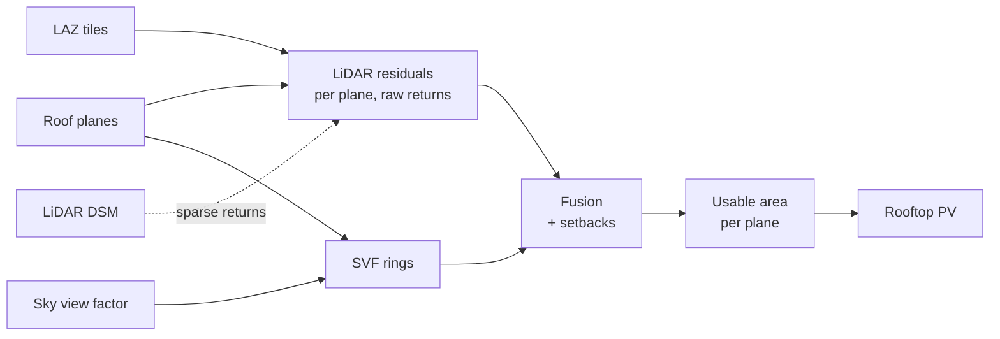

# Roof obstacles and the usable roof area

How `greenshadow.roof_obstacles` finds what stands on (or is sunk into) each
roof plane - chimneys, vents, air-conditioning units, parapets, lift rooms,
skylights, light wells - and cuts each plane down to the area a PV module
may be placed on. It runs between the roof planes
([roof_inference.md](roof_inference.md)) and the rooftop PV
([rooftop_pv.md](rooftop_pv.md)).

```python
import greenshadow as gs

cfg = gs.ObstacleConfig(lidar_classes=(1, 6, 17, 77))
lidar, qc = gs.detect_lidar_obstacles(planes, laz_paths, cfg,
                                      dsm_path="dsm_no_vegetation.tif")
svf = gs.detect_svf_obstacles(planes, "svf.tif", cfg)
obstacles, usable = gs.fuse_obstacles(planes, [lidar, svf], cfg, planes_qc=qc)
gs.write_obstacle_layers("roof_obstacles.gpkg", obstacles=obstacles,
                         usable_area=usable, planes_qc=qc)

modules, summary = gs.plan_pv_strings_in_buildings(
    planes, buildable_areas=usable, ...)
```



The obstacles stay in every DSM: they still cast shade on the roof around
them, and the hillshades and irradiation rasters keep that. Only the area a
module may stand on changes.

## 1. Why the raw returns

The planes are fitted to the refined roof DSM, which is built to make facets
clean - TIN sampling plus Delaunay smoothing - and which flattens clutter
into the roof: on the digitised Alpicat obstacles the median one cleared its
plane by only 0.09 m there ([roof_inference.md §3.4b](roof_inference.md)).
The DSM-residual cut the PV planner used to do on that surface
(`obstacle_residual_m`) could only find the tallest ones.

The residuals are therefore measured on the **LiDAR returns**, against each
plane **refitted to them**. On the Alpicat test window the ICGC returns
inside the roof planes are ~21 pts/m²; their spread about the refitted plane
is 0.016 m (median MAD σ) and the plane RMSE 0.019 m, so a 0.20 m object is
ten sigmas out.

The class matters. ICGC class 77, "other constructions", is where most
rooftop structures are: its returns inside the planes stand a median
**0.95 m** above them, against 0.00 m for class 6. Class 12 (overlap) mixes
roof and ground returns and is left out; ground, key-point and vegetation
classes never are obstacles. `CataloniaMunicipalityPipeline` reads classes
1, 6, 17 and 77 (`ROOF_OBSTACLE_CLASSES`); the default elsewhere is ASPRS 1
and 6.

## 2. LiDAR residual detector — `detect_lidar_obstacles`

Per roof (`part_id`), with the returns read once per tile group in a forked
process:

1. **Outline.** The roof's planes are unioned and gaps under
   `outline_close_m` closed. Returns inside it are kept.
2. **Home plane.** Each return goes to the plane it falls in, or to the
   nearest one (`STRtree.query_nearest`).
3. **Refit.** Each plane is refitted on its interior returns - RANSAC
   (`fit_threshold_m`, `fit_iterations`, seeded), then least squares on the
   inliers. If the refit leans more than `max_refit_angle_deg` off the
   detector's plane it has locked onto something else: the detector's
   orientation is kept, at the returns' median height (`fit="detector"`).
4. **Threshold.** σ = 1.4826 · MAD of the interior residuals (orthogonal,
   signed); a return is a candidate when |r| > max(`residual_k`·σ,
   `residual_min_m`) - 3σ and 0.20 m by default.
5. **Boundaries.** Within `boundary_buffer_m` of a plane boundary, and in
   the gaps between planes, a return belongs to two surfaces or to a facade.
   There it counts only if it stands above **every** plane within reach by
   more than max(threshold, `boundary_keep_above_m`): a chimney on the
   ridge is kept, while the eave drop, a facade seen at an angle and the
   wall of a step between two roof levels - all below one of the planes -
   are not. Returns in a gap farther than the buffer from any plane (a
   patch the detector left unplaned) are tested like interior ones.
6. **Clusters.** Candidates are clustered in plan with DBSCAN
   (`buildings_infer._dbscan_grid`), positives and negatives apart, with
   eps = clip(`cluster_eps_factor` / √density, `cluster_eps_min_m`,
   `cluster_eps_max_m`) and `cluster_min_samples` returns.
7. **Footprint.** Concave hull (`hull_ratio`, convex hull for degenerate
   clusters), widened by `hull_buffer_factor` × the point spacing.

**Minimum detectable obstacle.** About `cluster_min_samples` / density m²:
0.2 m² at the ICGC's ~15 pts/m², but 1.5-3 m² at 1-2 pts/m². For sparse
surveys lower `cluster_min_samples` (to 1-2) and rely on the raster residual.

**Raster residual.** Where a plane has fewer than `raster_min_density`
pts/m² (`raster_mode="fallback"`), or always (`"both"`), DSM − plane is
thresholded the same way and polygonized (`method="raster"`). The DSM must
still hold the clutter: the pipeline passes the 0.5 m LiDAR DSM (max
aggregation), never the refined roof DSM. The plane height is re-anchored on
the DSM, since a max-aggregated cell sits above the plane at its centre by
up to half a pixel times the slope. Without LAZ files this is the whole
detector.

**Outputs.** `obstacles`: `part_id`, `plane_id` (where most of its returns
are), `source="lidar"`, `method`, `sign` (+1 standing out, −1 sunk in),
`max_height_above_plane` (the signed extreme residual), `mean_residual`,
`n_points`, `area`. `planes_qc`: per plane, `n_points`, `density_pts_m2`,
`rmse_m` (of the roof returns, obstacles excluded), `sigma_m`,
`threshold_m`, `outlier_fraction`, `refit_angle_deg`, `fit`, `method` and
**`needs_review`** - set when there was no fit, too few returns
(`min_plane_points`), `rmse_m > max_plane_rmse_m`,
`outlier_fraction > max_outlier_fraction`, or a refit that tilted away.
A flagged plane is still used; it marks a cluttered roof or a doubtful
plane for a look.

## 3. Sky view factor detector — `detect_svf_obstacles`

The detector of `detect_roof_planes(svf_path=...)`
([roof_inference.md §3.4b](roof_inference.md)) - an object steals sky from
the roof around its base, printing a ring of depressed SVF - run on the
finished planes, roof by roof, at `svf_resolution_m` (0.2 m), with the
`svf_*` parameters tuned there. It sees objects whose returns the
classification or the thresholds missed; on its own it recalled 33% of the
digitised obstacles at 52% precision. `source="svf"`.

## 4. Fusion and usable area — `fuse_obstacles`

Overlapping detections of one roof become one obstacle whatever their
source; `sources` lists them (`"lidar"`, `"svf"`, `"lidar,svf"`). Then, per
plane:

```
usable = plane shrunk by seam_setback_m
       ∩ roof outline shrunk by edge_setback_m
       − obstacles buffered by obstacle_setback_m
```

opened at half `min_fragment_width_m` (mitred, so rectangular corners
survive) and stripped of pieces under `min_fragment_area_m2` (true area on
the roof). Both default to the narrowest and smallest of the PV modules
tried, so what is left can hold one. The **edge** setback applies along the
roof's outer edge only; the seams between two planes of one roof take the
small `seam_setback_m`.

`usable_area` has one row per plane with anything left: the plane's columns
plus `roof_area_m2` and `usable_area_m2` (true area, on the roof),
`obstacle_area_m2`, `n_obstacles` and `needs_review`.

## 5. Into the PV planner

`plan_pv_strings_in_buildings(buildable_areas=usable)` packs each plane's
usable area instead of applying its own `setback_m` and
`obstacle_residual_m` cut; a plane absent from it gets no modules. The
summary's `roof_area_m2` stays the whole plane's, so `buildable_area_m2`
and `coverage_ratio` show what the obstacles and setbacks cost.

## 6. In the pipeline

`PipelineConfig.roof_obstacles` (an `ObstacleConfig`, on by default; None
skips the stage, `--no-roof-obstacles` from the shell) runs right after the
roof planes. The LAZ files come from the region's `roof_lidar(aoi)` hook
(`RoofLidar(paths, classes)`); without it only the DSM residual and the SVF
are used. Output `roof_obstacles.gpkg`, reused unless
`ObstacleConfig.recalculate` or `recalculate_digital_models`:

| Layer | Content |
|---|---|
| `obstacles` | Fused obstacles, with `sources` |
| `usable_area` | What the PV planner packs, one row per plane |
| `planes_qc` | Fit quality and `needs_review`, on the plane polygons |
| `detections` | Every detection of every source, before fusion |

## 7. Parameters

| Parameter | Default | Note |
|---|---|---|
| `lidar_classes` | None → region (`(1, 6)`; Catalonia `(1, 6, 17, 77)`) | |
| `residual_k`, `residual_min_m` | 3, 0.20 m | |
| `fit_threshold_m`, `fit_iterations` | 0.05 m, 200 | RANSAC refit |
| `max_refit_angle_deg` | 10° | larger: keep the detector's plane, flag it |
| `boundary_buffer_m` | 0.3 m | band along plane boundaries |
| `boundary_keep_above_m` | 0.5 m | None: nothing in the band counts |
| `outline_close_m` | 0.25 m | gaps closed between a roof's planes |
| `cluster_eps_factor`, `_min_m`, `_max_m` | 2.0, 0.3, 1.0 m | eps from the point spacing |
| `cluster_min_samples` | 3 | sets the minimum detectable size |
| `hull_ratio`, `hull_buffer_factor` | 0.3, 0.5 | |
| `min_obstacle_area_m2`, `max_obstacle_area_m2` | 0, None | |
| `raster_mode`, `raster_min_density`, `raster_min_pixels` | `"fallback"`, 3 pts/m², 2 | |
| `max_plane_rmse_m`, `max_outlier_fraction`, `min_plane_points` | 0.08 m, 0.25, 20 | `needs_review` |
| `svf`, `svf_resolution_m`, `svf_*` | True, 0.2 m, as tuned in roof_inference.md | |
| `obstacle_setback_m` | 0.3 m | |
| `edge_setback_m` | 0.3 m | outer edge only |
| `seam_setback_m` | 0.05 m | between planes |
| `min_fragment_width_m`, `min_fragment_area_m2` | None → from the modules | |

## 8. Results

**Alpicat, whole municipality** (`roofs_rasterised.gpkg`: 10,976 planes on
1,528 roofs; 2026-10-27, 8 workers):

| Stage | Time | Result |
|---|---|---|
| Roof returns (each LAZ decoded once, XYZ + class) | 18 s | 23 files |
| LiDAR residuals | 160 s | 9,690 detections (8,710 standing out, 980 sunk in; 30 from the DSM) |
| Sky view factor | 15 s | 1,879 detections |
| Fusion and usable area | 56 s | 10,681 obstacles (8,822 LiDAR, 1,211 SVF, 648 both), 25,500 m², median 0.54 m² |

Plane quality: median 12 returns/m² in the planes, median RMSE 0.020 m
(90th percentile 0.054 m); 10,336 planes refitted, 529 kept at the
detector's orientation, 111 without returns; **884 (8%) need review**.

**Effect on the rooftop PV**, `best` scenario, pipeline capacity settings,
2023 irradiation:

| Usable area | Modules | MWp | GWh/year | Buildable m² |
|---|---|---|---|---|
| No obstacle removal, 0.05 m setback | 142,298 | 61.98 | 74.80 | 458,916 |
| Previous: refined-DSM residual cut, 0.05 m setback | 109,947 | 47.88 | 59.14 | 383,626 |
| Obstacles, `edge_setback_m=0.05` | 122,020 | 52.72 | 64.54 | 397,943 |
| **Obstacles, defaults** (`edge_setback_m=0.3`) | **110,376** | **47.89** | **58.98** | **363,785** |
| Obstacles from the LiDAR only (no SVF), defaults | 111,855 | 48.53 | 59.76 | 366,531 |

The obstacles cost 14% of the modules an unobstructed roof would take; the
0.3 m roof-edge setback another 10%. The previous residual cut removed more
(23%) on more buildable area: on the refined DSM it cut out scattered
pixels of noise that break module rows without taking much area. The two
totals end up within 0.5% of each other, but the modules are not in the
same places.

## 9. Limitations and what is next

* **Not yet scored.** The 48 digitised obstacles the SVF detector was tuned
  on (`real_roof_obstacles_9000_9500_4000_5000_Alpicat.gpkg`) are no longer
  on disk, so precision and recall of this detector are still to be
  measured. A labelled set with classes (chimney, skylight, panel ...) on
  more than one window is the next step.
* Flat objects do not stand out of the plane: skylights flush with the
  roof, roof windows and existing PV modules are invisible to the residuals
  and to the SVF. The orthophoto detector (SAM3) is planned for those.
* Dormers that the roof detector made into planes of their own are planes,
  not obstacles, and get modules.
* A plane fitted across two real surfaces shows up as a long negative or
  positive strip and as `needs_review`; the strip is cut from the usable
  area.
