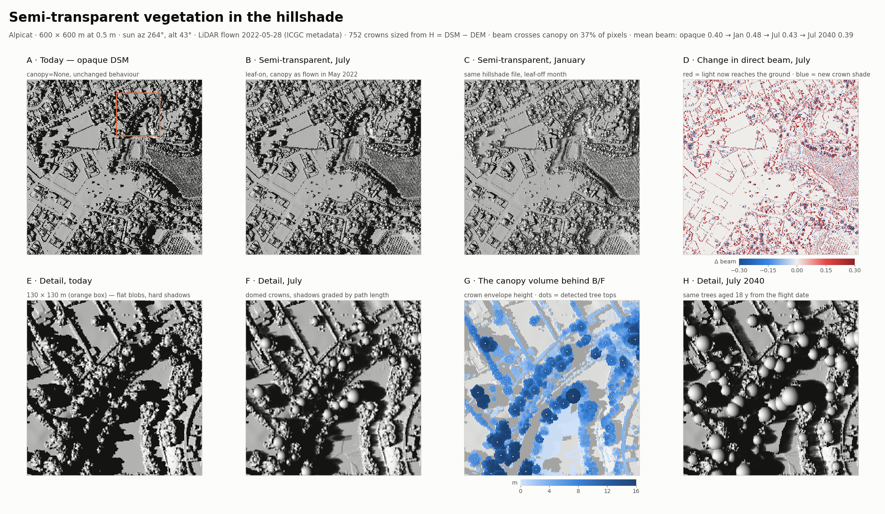

# Semi-transparent vegetation

A plain DSM turns a tree into an extruded column and its shadow into a hard
black blob. The canopy model of `greenshadow.shader` makes trees a medium the
beam is attenuated through instead, with crown-shaped tops, seasonal leaves,
and growth from the LiDAR flight to the simulated year.



```python
flown = gs.icgc_lidar_acquisition_date(aoi, cache_dir=laz_dir)   # e.g. 2022-05-28

canopy = gs.build_canopy_model_from_rasters(
    dsm_path=dsm, dem_path=dem, class_path=dsm_class,
    under_canopy_path=dsm_no_vegetation,
    growth=gs.vegetation_growth(flown, 2040))   # omit for the canopy as flown

gs.generate_multiple_hillshades_gdal(..., canopy=canopy)
gs.compute_surface_solar_energies(..., canopy_leaf_type=0)   # 0 deciduous, 1 evergreen
```

It is opt-in throughout: with `canopy=None` the hillshades are the
original single-band opaque ones, byte for byte. The pipeline enables it
with `semitransparent_vegetation=True`.

## 1. The model (`build_canopy_model`)

From the DSM, the DEM and the class raster on one grid:

* **Tree crowns.** High-vegetation pixels (class 5) are resolved into
  individual trees: peaks of the canopy height model `H = DSM − DEM`
  (`detect_tree_crowns`, after a `smooth_sigma_m` = 1.5 m Gaussian, peaks
  under `min_tree_height_m` = 3 m ignored). Each crown is a half-ellipsoid
  of diameter `D = a·H^b` (`crown_a` = 1.0, `crown_b` = 0.8), capped at
  `max_crown_radius_m` = 9 m and at `observed_radius_factor` = 2 times the
  radius of the tree's own LiDAR blob, so a street tree does not inherit a
  forest-sized crown. Its depth is `crown_ratio` = 0.65 of the height.
* **Low and medium vegetation** (classes 3, 4) keep the DSM column, which
  describes a shrub well enough. High-vegetation pixels no crown reached
  fall back to the column too, so the gaps between packed crowns still
  attenuate.
* **What is still opaque**: the DSM everywhere but the vegetation, dropping
  to `under_canopy_path` (the DSM without vegetation; the DEM by default)
  beneath a crown.
* **What is drawn**: the DSM with crowns replaced by their envelope, so the
  local hillshade shows domes instead of LiDAR speckle.

The result is a `CanopyModel` (`crown_top`, `crown_base`, `class_index`,
`opaque`, `render_surface`, `trees`). `build_canopy_model_from_rasters`
reads and reprojects the rasters onto the DSM grid and nearest-fills holes.
On Alpicat it finds 15,645 trees.

## 2. Ray-marching (`cast_canopy_path_lengths`)

For each sun position the ray toward the sun is marched through the scene.
It stops at an opaque obstacle (shadow) and otherwise **accumulates the
metres of crown it crosses**, per height class. Those path lengths are bands
2-4 of the canopy hillshade (`canopy_path_low_m`, `..._medium_m`,
`..._high_m`); band 1 is the local shading with the opaque shadows only.

Path lengths are geometry: they do not depend on the season, so one
hillshade per `(azimuth, altitude)` still serves the whole year.

## 3. Attenuation at read time

The month enters only when a hillshade is read. `VEGETATION_SHADOWING` is a
leaf type × height class × month table of the fraction `s` of the beam
stopped by one full vertical crossing of a crown of nominal thickness
(`VEGETATION_REFERENCE_THICKNESS_M` = 1, 2.5, 6 m for low, medium, high).
`vegetation_extinction(month, leaf_type)` turns it into Beer-Lambert
coefficients `μ = −ln(1 − s) / thickness`, and
`apply_canopy_transmittance` gives the beam fraction

    beam = band1 · exp(−Σ_c μ_c · path_c)

so crown edges, crossed over a short path, are lighter than crown centres,
and dappled shade appears where an opaque mask gave black.

| Stopped by one crossing | Jan | Apr | Jul | Oct |
|---|---|---|---|---|
| Deciduous, high | 0.30 | 0.65 | 0.92 | 0.65 |
| Evergreen, high | 0.75 | 0.80 | 0.90 | 0.85 |

The energy sums resolve every `(azimuth, altitude)` bin per month for this
reason ([solar_energy.md](solar_energy.md)), and `load_hillshade` refuses to
read a canopy hillshade without a month (`ignore_canopy=True` reads band 1
only, i.e. transparent vegetation, on purpose).

## 4. Growth since the flight

LiDAR is a snapshot; simulating a later year with the trees at flight size
under-shades. `vegetation_growth(lidar_date, simulation_date)` returns a
`VegetationGrowth`:

* **additive** (default): `height_rate_m_per_year` = 0.25 m of height and
  `crown_rate_m_per_year` = 0.20 m of crown diameter per year;
* **relative**: `relative_rate_per_year` (e.g. 0.02) scales both
  multiplicatively, for young or fast-growing stands;
* heights are capped at `max_height_m` = 40 m; a simulated year before the
  flight shrinks the trees.

The flight date comes from the ICGC tile metadata
(`icgc_lidar_acquisition_date`, area-weighted midpoint of the flight
windows). With either date missing the growth is the identity.

## 5. Limitations

* The allometry (`crown_a`, `crown_b`, `crown_ratio`) and the
  `VEGETATION_SHADOWING` table are literature defaults, **not fitted** to
  Catalan species.
* `leaf_type` is one global switch, not a per-tree attribute (it could come
  from a species layer or NDVI seasonality).
* Elevated shadows (`apply_height_shadow_to_hillshades`) keep band 1 only:
  the shade the trees cast is lost there (band 1 holds the opaque shadows
  alone), while the tree pixels themselves are blacked out like any other
  object taller than the chosen height.
* The growth rates are generic for established urban trees.
